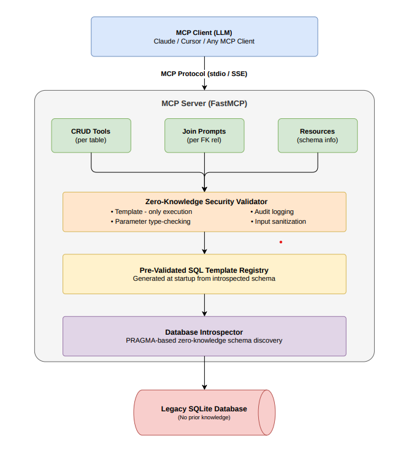

# Self-Documenting Zero-Knowledge MCP Server


A **Model Context Protocol (MCP)** server that autonomously scans an undocumented legacy database, generates CRUD tools for every table, creates prompts explaining how to join tables, and enforces **Zero-Knowledge security** by restricting the LLM to pre-validated SQL templates only.

## Architecture



## Why MCP — and What the Real Engineering Is

MCP (Model Context Protocol) is the transport and interface layer here — it handles how the LLM calls tools, passes parameters, and receives results. It is a deliberate *choice*, not the achievement.

The actual engineering in this project is the **schema-introspection and security pipeline** that sits underneath:

```
Database → PRAGMA Introspection → Schema Registry → Template Engine → Security Validator → MCP Tools
```

Each stage has zero knowledge of the next. The introspector knows nothing about MCP. The template engine knows nothing about security. The CRUD generator knows nothing about SQL — it only works with template IDs. This strict separation means you could swap the MCP transport for a REST API or a gRPC service without touching a single line of the security layer.

MCP was chosen over direct OpenAI function-calling because MCP is transport-agnostic (stdio for local use, SSE for network), supports resources and prompts beyond raw tool calls, and is the open standard being adopted across the LLM tooling ecosystem. But the security layer — pre-validated templates, defense-in-depth sanitization, immutable template registry — works identically regardless of what protocol sits in front of it.


## Features

- **Autonomous Schema Discovery** — Scans any SQLite database using PRAGMA introspection with zero prior knowledge
- **Dynamic CRUD Tools** — Auto-generates Create, Read, Update, Delete, List, and Search tools for every discovered table
- **Join Prompts** — Analyzes foreign key relationships and generates prompts explaining how to join tables
- **Zero-Knowledge Security** — All SQL execution is restricted to pre-validated parameterized templates
- **Audit Logging** — Every database operation is logged with timestamp, template ID, and parameters
- **Schema Resources** — MCP resources expose the discovered schema for LLM reference


## Quick Start

### Prerequisites

- Python 3.10+
- pip

### Installation

```bash
# Clone the repository
git clone https://github.com/Utkarsh-Srivastava29/Self-Documenting-Zero-Knowledge-MCP-Server.git
cd "MCP SERVER"

# Install dependencies
pip install -r requirements.txt

# Or install in editable mode with dev tools (recommended)
pip install -e ".[dev]"
```

### Seed the Demo Database

```bash
# Create a sample e-commerce legacy database
python server.py --seed
```

This creates `legacy_store.db` with 6 tables: `categories`, `customers`, `orders`, `order_items`, `products`, `reviews` — complete with foreign key relationships and sample data.

### Run the Server

```bash
# Run with stdio transport (default — for Claude Desktop)
python server.py

# Run with SSE transport (for network access)
python server.py --transport sse --port 8080

# Use a custom database
python server.py --db /path/to/your/database.db
```

### Connect with Claude Desktop

Add to your Claude Desktop config (`claude_desktop_config.json`):

```json
{
  "mcpServers": {
    "zk-database": {
      "command": "python",
      "args": ["C:/path/to/MCP SERVER/server.py", "--db", "C:/path/to/legacy_store.db"]
    }
  }
}
```

### Test with MCP Inspector

```bash
mcp dev server.py
```


## What Gets Generated

When the server starts, it introspects the database and auto-generates:

### Tools (per table)
| Tool | Description |
|:-----|:------------|
| `create_{table}` | Insert a new row with auto-generated parameter docs |
| `read_{table}` | Read a row by primary key |
| `update_{table}` | Update a row by primary key |
| `delete_{table}` | Delete a row by primary key |
| `list_{table}` | Paginated listing with limit/offset |
| `search_{table}` | Full-text search across text columns |

### Prompts
| Prompt | Description |
|:-------|:------------|
| `join_{table_a}_and_{table_b}` | Explains how to join two related tables |
| `explore_database` | Complete database exploration guide |
| `show_schema` | Full auto-discovered schema display |

### Resources
| Resource URI | Description |
|:-------------|:------------|
| `schema://tables` | Full schema overview |
| `schema://tables/{name}` | Per-table schema details |
| `security://audit-log` | Recent query audit log |
| `security://report` | Security summary report |
| `security://templates` | All registered SQL templates |


## Security Model

The **Zero-Knowledge** security model ensures the LLM never constructs or sees raw SQL:

1. **Template-Only Execution** — Only SQL from the pre-generated template registry can be executed. No raw SQL endpoint exists.
2. **Parameter Validation** — All parameters are type-checked against the introspected schema before execution.
3. **Input Sanitization** — Defense-in-depth blocklist catches SQL injection patterns in parameter values (even though parameterized queries already prevent injection).
4. **Audit Trail** — Every operation is logged with timestamp, template ID, parameters, success/failure status.
5. **No Schema Manipulation** — Only SELECT, INSERT, UPDATE, DELETE on existing tables. No DDL operations are possible.

See [SECURITY.md](SECURITY.md) for the full security model, including known scope boundaries (transport-layer auth).


## Why SQLite — and What Changes at Scale

SQLite was chosen deliberately for this demo for three reasons:

1. **Zero configuration** — no separate server, credentials, or network config; the DB is a single file
2. **Native PRAGMA introspection** — `PRAGMA table_info()`, `PRAGMA foreign_key_list()` are the exact tools the zero-knowledge discovery depends on
3. **stdlib only** — no ORM dependency; `import sqlite3` ships with Python

**What would change in production:**

| Concern | Current (SQLite) | Production path |
|---------|----------------|-----------------|
| Concurrency | Single-writer | PostgreSQL + `asyncpg` + connection pool |
| Introspection | PRAGMA statements | `information_schema` (standard SQL, DB-agnostic) |
| Audit log | In-memory list | Append-only DB table or structured JSON logs |
| DB path config | CLI flag | `DATABASE_URL` env var (12-factor) |
| Migrations | Re-seed | `alembic` migration scripts |

The architecture is database-agnostic by design — only `src/introspector.py` contains SQLite-specific code (~80 lines). Swapping the backing database means replacing that single file; the security layer, CRUD generator, and MCP registration are untouched.

See [docs/DECISIONS.md](docs/DECISIONS.md) for all architectural decision records.


## Running Tests

```bash
# Run all tests
python -m pytest

# Run with coverage report
python -m pytest --cov=src --cov-report=term-missing

# Run specific test files
python -m pytest tests/test_security.py -v
python -m pytest tests/test_introspector.py -v
```


## Project Structure

```
MCP SERVER/
├── .github/workflows/ci.yml    # CI pipeline (pytest + ruff + coverage)
├── .gitignore                  # Git ignore rules
├── .env.example                # Environment variable template
├── CHANGELOG.md                # Version history
├── CONTRIBUTING.md             # Dev setup and contribution guide
├── Makefile                    # Developer convenience commands
├── README.md                   # Project documentation
├── SECURITY.md                 # Security model + transport scope boundary
├── server.py                   # Main MCP server entry point
├── requirements.txt            # Python dependencies
├── pyproject.toml              # Project metadata, ruff + pytest + coverage config
├── src/
│   ├── __init__.py
│   ├── introspector.py         # PRAGMA-based schema discovery
│   ├── schema_registry.py      # In-memory schema registry
│   ├── sql_templates.py        # Pre-validated SQL template engine
│   ├── security.py             # Zero-Knowledge security validator
│   ├── crud_generator.py       # Dynamic MCP tool generator
│   └── join_analyzer.py        # FK analysis & prompt generator
├── sample_data/
│   └── seed_legacy_db.py       # Demo legacy database seeder
├── tests/
│   ├── conftest.py             # Shared pytest fixtures
│   ├── demo_client.py          # Standalone verification demo
│   ├── test_introspector.py    # Schema discovery tests
│   ├── test_crud.py            # CRUD operation tests
│   ├── test_security.py        # Security validation tests
│   └── test_joins.py           # Join analysis tests
└── docs/
    ├── API_REFERENCE.md        # API reference documentation
    ├── APPROACH.md             # Full technical approach write-up
    ├── CLIENT_INTEGRATION_GUIDE.md  # LLM agent integration guide
    ├── CONFIGURATION.md        # Configuration reference guide
    ├── DECISIONS.md            # Architectural Decision Records (ADRs)
    ├── DEPLOYMENT.md           # Production deployment & operations guide
    ├── TESTING.md              # Testing guide & test suite documentation
    ├── TROUBLESHOOTING.md      # Comprehensive troubleshooting & diagnostics
    └── MCP_architecture.png    # Architecture diagram
```


## License

MIT
