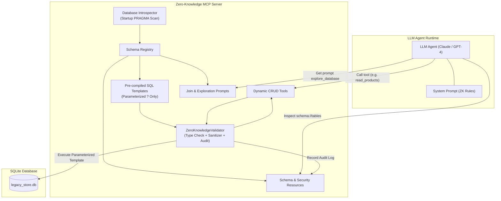
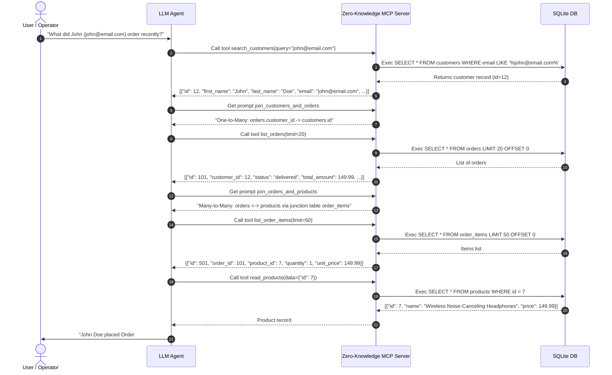
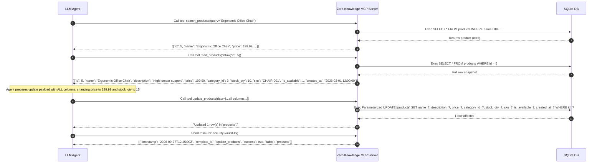
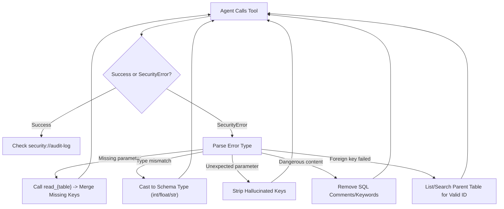

# Client Integration Guide — Self-Documenting Zero-Knowledge MCP Server

This guide provides technical specifications, integration patterns, and architectural best practices for AI engineers building LLM agents (using Anthropic Claude, OpenAI, LangChain, LlamaIndex, AutoGen, or custom agent runtimes) that interact with the **Self-Documenting Zero-Knowledge MCP Server**.

---

## Table of Contents

1. [The Zero-Knowledge Mental Model](#1-the-zero-knowledge-mental-model)
2. [Recommended System Prompt for LLM Agents](#2-recommended-system-prompt-for-llm-agents)
3. [Standard Agent Interaction Patterns (The 5-Phase Lifecycle)](#3-standard-agent-interaction-patterns-the-5-phase-lifecycle)
   - [Phase 1: Discovery](#phase-1-discovery)
   - [Phase 2: Exploration](#phase-2-exploration)
   - [Phase 3: Relationship Analysis](#phase-3-relationship-analysis)
   - [Phase 4: Operations](#phase-4-operations)
   - [Phase 5: Verification](#phase-5-verification)
4. [Real-World Workflow Examples](#4-real-world-workflow-examples)
   - [Example 1: Customer Order Lookup](#example-1-customer-order-lookup)
   - [Example 2: Safe Product Price & Inventory Update](#example-2-safe-product-price--inventory-update)
   - [Example 3: Sentiment & Review Analysis](#example-3-sentiment--review-analysis)
5. [Error Recovery & Exception Handling](#5-error-recovery--exception-handling)
6. [Available MCP Endpoints Reference Table](#6-available-mcp-endpoints-reference-table)
7. [Programmatic Client Integration Code Snippets](#7-programmatic-client-integration-code-snippets)

---

## 1. The Zero-Knowledge Mental Model

In traditional database agent architectures (Text-to-SQL), the LLM is tasked with translating unstructured user intentions into raw SQL strings (e.g., `SELECT * FROM users WHERE ...`). While flexible, this approach introduces critical production risks:

- **SQL Injection & Jailbreaking:** Adversarial users can trick the LLM into generating destructive queries (`DROP TABLE`, `TRUNCATE`, data exfiltration via `UNION SELECT`).
- **SQL Hallucination:** LLMs hallucinate non-existent table names, invalid columns, incorrect syntax dialect quirks, and invalid join keys.
- **Uncontrolled Data Modification:** Ambiguous updates or deletes without strict primary key matching can result in catastrophic data corruption.

```
Traditional Text-to-SQL (High Risk):
User Prompt ──> LLM ──> [Raw SQL Query String] ──> Database Engine (Vulnerable)

Zero-Knowledge MCP Architecture (Zero Risk):
User Prompt ──> LLM ──> [Typed Tool Call] ──> ZeroKnowledgeValidator ──> [Pre-compiled Template] ──> Database Engine
```

### Core Architecture Tenets



1. **The LLM Never Writes or Sees SQL:**
   The model does not formulate SQL syntax. It functions strictly as a **structured business operator**, issuing JSON payloads against pre-compiled tool endpoints.
2. **Pre-Validated Templates:**
   At server startup, the database is introspected via SQLite PRAGMA commands. The server automatically compiles parameterized templates for every discovered table and relationship. SQL statements are immutable and frozen in memory.
3. **Strict Parameter Typing & Whitelisting:**
   All arguments passed to tools are validated against database schemas. Extra parameters are blocked, missing parameters cause deterministic failures, and types are validated against SQLite affinities (`INTEGER`, `REAL`, `TEXT`, `TIMESTAMP`).
4. **Defense-in-Depth Sanitization:**
   Even though parameterized queries inherently block SQL injection, inputs are screened against a signature blocklist (e.g., `; DROP`, `UNION SELECT`, `--`, `/* */`, `sqlite_master`).
5. **Full Operational Traceability:**
   Every tool invocation (success or failure) is logged into an in-memory audit log exposed as an MCP resource (`security://audit-log`), enabling autonomous agent self-verification.

---

## 2. Recommended System Prompt for LLM Agents

When configuring LLM agents (Claude Desktop, OpenAI Assistant, LangChain/LangGraph, CrewAI, AutoGen) that connect to this server, inject the following system prompt instructions into the agent's context.

```markdown
You have access to a Zero-Knowledge database server via MCP tools.
Key rules:
- NEVER attempt to write or execute raw SQL.
- Use `explore_database` prompt first to understand the schema.
- Use `schema://tables` resource for detailed column info.
- Use `join_*` prompts to understand table relationships.
- All parameters are strictly type-checked — provide correct types.
- Use `list_{table}` to browse data before making changes.
- Check `security://audit-log` to verify your operations.
```

### Production Extended System Prompt

For autonomous agent runtimes in production, use this expanded prompt to enforce operational best practices:

```markdown
You are an enterprise data operator interacting with a secure Zero-Knowledge database via MCP.
You have NO direct SQL access and must NEVER generate SQL syntax.

OPERATIONAL PROTOCOL:
1. DISCOVERY: Always inspect `schema://tables` or run the `explore_database` prompt before querying unfamiliar domains.
2. EXPLORATION: When searching for records, run `search_{table}` or inspect samples with `list_{table}(limit=10)`. Never request more than 100 rows in a single listing.
3. JOINS: Do not attempt custom table joins. Call the relevant `join_{table_a}_and_{table_b}` prompt to understand primary-to-foreign key mappings, then perform correlated tool calls.
4. UPDATES: To update a row, you MUST first fetch the full row using `read_{table}`. The `update_{table}` tool requires ALL table columns in the payload. Modify only the required field while preserving unchanged fields.
5. TYPES: Supply native JSON types (integers as numbers, prices as floats, text as strings). Do not send numbers as strings unless the column is TEXT.
6. VERIFICATION: After performing any state-changing operation (`create_*`, `update_*`, `delete_*`), read `security://audit-log` or `security://report` to confirm row counts and execution status.
```

---

## 3. Standard Agent Interaction Patterns (The 5-Phase Lifecycle)

Agents follow a deterministic 5-phase interaction cycle when interacting with the server:

```
[Phase 1: Discovery] ──> [Phase 2: Exploration] ──> [Phase 3: Relationships] ──> [Phase 4: Operations] ──> [Phase 5: Verification]
```

### Phase 1: Discovery
Before taking any action, the agent must inspect the available database topology. The server provides both structured resource URIs and human-readable prompts.

- **Option A (MCP Resource):** Read `schema://tables`
  Returns the complete schema summary generated at startup, including all tables, column types, nullability, defaults, and primary/foreign key flags.
- **Option B (MCP Prompt):** Invoke `show_schema`
  Returns an introspected schema report formatted for LLM consumption.
- **Option C (Table-Specific Resource):** Read `schema://tables/{table_name}`
  Returns column-level details specifically for `{table_name}` (e.g., `schema://tables/customers`).

### Phase 2: Exploration
Once the agent understands which tables exist, it investigates the records:

- **Paginated Listing (`list_{table}`):**
  Inspect existing records using `limit` (1–100, default 20) and `offset` (default 0).
  ```json
  {
    "tool": "list_products",
    "arguments": {
      "limit": 5,
      "offset": 0
    }
  }
  ```
- **Text Search (`search_{table}`):**
  Locate specific records across text columns (`TEXT`, `VARCHAR`, `CHAR`) without needing wildcards:
  ```json
  {
    "tool": "search_customers",
    "arguments": {
      "query": "john@example.com"
    }
  }
  ```

### Phase 3: Relationship Analysis
Because the agent cannot write `JOIN` queries directly, it coordinates data across tables using pre-analyzed relationship guidance:

- **Pairwise Join Prompts (`join_{table_a}_and_{table_b}`):**
  Provides explicit foreign-key linkages and sample SQL demonstrating how rows correlate. Table names in prompt identifiers are sorted alphabetically (e.g., `join_customers_and_orders`, `join_categories_and_products`, `join_orders_and_products`).
- **Global Guide (`explore_database`):**
  Provides a bird's-eye view of all one-to-many and junction-table many-to-many relationships across the entire database.

### Phase 4: Operations
All CRUD operations are executed via pre-compiled tool interfaces:

- **`read_{table}`:**
  Fetch an individual record by primary key.
  ```json
  {
    "tool": "read_customers",
    "arguments": {
      "data": {
        "id": 42
      }
    }
  }
  ```
- **`create_{table}`:**
  Insert a new record. Provide all non-primary key columns that are required.
  ```json
  {
    "tool": "create_categories",
    "arguments": {
      "data": {
        "name": "Electronics",
        "description": "Hardware and peripherals"
      }
    }
  }
  ```
- **`update_{table}` (Read-Modify-Write Rule):**
  > [!IMPORTANT]
  > The `update_{table}` tool requires **ALL** columns for the table (both non-PK attributes and the PK). The server generates parameterized `UPDATE [table] SET col1=?, col2=? WHERE pk=?` queries. If any column is omitted, the security validator will throw a `SecurityError: Missing parameter`. The agent must first `read_{table}`, update the target fields in memory, and pass the complete object back.
  ```json
  {
    "tool": "update_products",
    "arguments": {
      "data": {
        "id": 5,
        "name": "Pro Keyboard",
        "description": "Mechanical gaming keyboard",
        "price": 89.99,
        "category_id": 2,
        "stock_qty": 45,
        "sku": "KB-PRO-001",
        "is_available": 1,
        "created_at": "2026-01-15 10:00:00"
      }
    }
  }
  ```
- **`delete_{table}`:**
  Remove a record strictly by its primary key.
  ```json
  {
    "tool": "delete_reviews",
    "arguments": {
      "data": {
        "id": 108
      }
    }
  }
  ```

### Phase 5: Verification
After performing any data modification, agents verify execution by reading audit resources:

- **`security://audit-log`:**
  Returns recent operations with timestamps, template IDs, parameters passed, row counts affected, and execution outcomes.
- **`security://report`:**
  Provides an aggregated summary of total queries executed, success rates, and any security violations caught.

---

## 4. Real-World Workflow Examples

### Example 1: Customer Order Lookup

**Goal:** An agent needs to find the orders and purchased items for a customer with email `john@email.com`.



#### Step-by-Step Tool Invocations:

1. **Search for Customer:**
   ```json
   {
     "name": "search_customers",
     "arguments": { "query": "john@email.com" }
   }
   ```
   *Response:* `[{"id": 12, "first_name": "John", "last_name": "Doe", "email": "john@email.com"}]`

2. **Understand Relational Link:**
   The agent retrieves the prompt `join_customers_and_orders`:
   > Join column: `orders.customer_id` → `customers.id`

3. **Locate Orders:**
   The agent calls `list_orders` and filters in memory for `customer_id == 12`:
   ```json
   {
     "name": "list_orders",
     "arguments": { "limit": 20, "offset": 0 }
   }
   ```

4. **Correlate Order Items:**
   Using the junction table prompt `join_orders_and_products`, the agent reads items from `order_items` matching `order_id == 101`, and resolves `product_id == 7` using `read_products(data={"id": 7})`.

---

### Example 2: Safe Product Price & Inventory Update

**Goal:** Increase the price of product "Ergonomic Office Chair" (SKU `CHAIR-001`) from $199.99 to $229.99 and update stock quantity to 15.



#### Step-by-Step Tool Invocations:

1. **Locate Product ID:**
   ```json
   {
     "name": "search_products",
     "arguments": { "query": "Ergonomic Office Chair" }
   }
   ```
2. **Read Current Snapshot:**
   ```json
   {
     "name": "read_products",
     "arguments": { "data": { "id": 5 } }
   }
   ```
3. **Execute Full-Row Update:**
   ```json
   {
     "name": "update_products",
     "arguments": {
       "data": {
         "id": 5,
         "name": "Ergonomic Office Chair",
         "description": "High lumbar support",
         "price": 229.99,
         "category_id": 3,
         "stock_qty": 15,
         "sku": "CHAIR-001",
         "is_available": 1,
         "created_at": "2026-02-01 12:00:00"
       }
     }
   }
   ```
   *Response:* `"Updated 1 row(s) in 'products'."`

4. **Verify Audit Trail:**
   The agent reads resource `security://audit-log` to confirm that the operation succeeded without security violations.

---

### Example 3: Sentiment & Review Analysis

**Goal:** Identify negative reviews across the product catalog and correlate them with specific products to report quality issues.

1. **List Recent Reviews:**
   ```json
   {
     "name": "list_reviews",
     "arguments": { "limit": 50, "offset": 0 }
   }
   ```
2. **Filter by Sentiment Keywords:**
   The agent executes targeted keyword searches:
   ```json
   {
     "name": "search_reviews",
     "arguments": { "query": "terrible" }
   }
   ```
   *Response:*
   ```json
   [
     {
       "id": 44,
       "product_id": 8,
       "customer_id": 19,
       "rating": 1,
       "title": "Terrible quality",
       "comment": "Broke on the first day of use. Do not buy.",
       "review_date": "2026-09-20 14:15:22"
     }
   ]
   ```
3. **Correlate with Product Information:**
   The agent reads `join_products_and_reviews` to confirm `reviews.product_id` references `products.id`:
   ```json
   {
     "name": "read_products",
     "arguments": { "data": { "id": 8 } }
   }
   ```
   *Response:*
   ```json
   [
     {
       "id": 8,
       "name": "Ultra-Slim USB Hub",
       "price": 24.99,
       "sku": "HUB-USB-008"
     }
   ]
   ```
4. **Agent Synthesis:**
   The agent synthesizes the findings: Product *"Ultra-Slim USB Hub"* (SKU: `HUB-USB-008`) received 1-star feedback reporting structural failure on day one.

---

## 5. Error Recovery & Exception Handling

The Zero-Knowledge validator enforces strict guarantees. When an agent violates a constraint, a `SecurityError` is returned. Agents must be programmed to interpret these errors and perform autonomous recovery.

| Exception Message Pattern | Underlying Cause | Agent Self-Correction Strategy |
| :--- | :--- | :--- |
| `SecurityError: Missing parameter '{param}' for template '{template}'` | The agent omitted a required table column (most common in `update_{table}` calls). | 1. Call `read_{table}` with the PK to obtain current column values.<br/>2. Re-construct the update payload with **all** non-PK and PK fields included.<br/>3. Re-send `update_{table}`. |
| `SecurityError: Unexpected parameter '{param}' for template '{template}'` | The agent supplied an extraneous attribute not present in the table schema. | 1. Read `schema://tables/{table_name}` to inspect the exact column names.<br/>2. Strip any extraneous or hallucinated keys from the dictionary.<br/>3. Re-issue the tool call. |
| `SecurityError: Type mismatch for parameter '{param}': expected {type}, got {actual}` | Argument type violation (e.g., passing `"5"` as string where `INTEGER` or `REAL` is expected). | 1. Parse the expected type from the error message (`INTEGER`, `REAL`, `TEXT`, `TIMESTAMP`).<br/>2. Cast parameter (e.g., `int(val)` or `float(val)`).<br/>3. Re-send tool call. |
| `SecurityError: Unknown template '{id}'` | The agent called an unregistered tool or constructed an invalid template name. | 1. Query the MCP tools list to discover active registered tools.<br/>2. Verify table name spelling against `schema://tables`. |
| `SecurityError: Potentially dangerous content detected in parameter '{param}'` | Input triggered the defense-in-depth regex blocklist (e.g., `; DROP`, `UNION SELECT`, `--`, `/* */`). | 1. Inspect the input string for SQL comments or SQL keywords.<br/>2. Sanitize and remove SQL tokens from the user input field.<br/>3. Re-issue the query. |
| `SecurityError: Database error executing '{id}': FOREIGN KEY constraint failed` | Relational integrity violation (e.g., inserting a product with a `category_id` that does not exist). | 1. Use `list_{parent_table}` or `search_{parent_table}` to verify foreign key values.<br/>2. Correct the ID reference to point to an existing parent row. |
| `SecurityError: Database error executing '{id}': UNIQUE constraint failed` | Duplicated unique field (e.g., email or SKU already exists). | 1. Perform `search_{table}` on the unique field to locate existing conflict.<br/>2. Generate an alternate unique value or update the existing row. |

### Error Recovery State Machine for Agents



---

## 6. Available MCP Endpoints Reference Table

### Tools (Dynamically Generated per Discovered Table)

| Tool Name Pattern | Parameters | Parameter Types | Output Description | Zero-Knowledge Guarantee |
| :--- | :--- | :--- | :--- | :--- |
| `create_{table}` | `data` | `dict[str, Any]` (Non-PK columns) | Confirmation message with newly assigned `last_insert_id`. | Pre-compiled `INSERT INTO [table] (...) VALUES (...)`. No SQL passed. |
| `read_{table}` | `data` | `dict[str, Any]` (Primary Key columns only) | List of matching record dictionaries, or not-found string. | Pre-compiled `SELECT * FROM [table] WHERE pk = ?`. |
| `update_{table}` | `data` | `dict[str, Any]` (**All** columns: non-PK + PK) | Confirmation message with count of `affected_rows`. | Pre-compiled `UPDATE [table] SET ... WHERE pk = ?`. Prevents partial payload corruption. |
| `delete_{table}` | `data` | `dict[str, Any]` (Primary Key columns only) | Confirmation message with count of `affected_rows`. | Pre-compiled `DELETE FROM [table] WHERE pk = ?`. Cannot perform bulk deletes without PK. |
| `list_{table}` | `limit`<br/>`offset` | `limit: int` (default: 20, max: 100)<br/>`offset: int` (default: 0) | List of row dictionaries matching page slice. | Pre-compiled `SELECT * FROM [table] LIMIT ? OFFSET ?`. Memory bounded. |
| `search_{table}` | `query` | `query: str` (Search string) | List of matching rows across all detected text columns (max 50). | Pre-compiled `SELECT * FROM [table] WHERE col1 LIKE ? OR col2 LIKE ?`. Uses `?` wildcards. |

### Resources (Auto-Discovered Schema & Security Telemetry)

| Resource URI | MIME Type | Description & Purpose | Sample Usage |
| :--- | :--- | :--- | :--- |
| `schema://tables` | `text/plain` | Complete database schema summary: all discovered tables, row counts, columns, types, nullability, primary and foreign keys. | Used during Phase 1 Discovery to ground agent context. |
| `schema://tables/{table_name}` | `text/plain` | Deep inspection of a single table's column definitions and constraints. | Used when preparing payloads for `create_*` or `update_*`. |
| `security://audit-log` | `application/json` | JSON list of the last 50 executed queries with timestamps, template IDs, parameters, row counts, and status. | Used during Phase 5 Verification to confirm operations. |
| `security://report` | `application/json` | Aggregated security metrics: total queries executed, success count, failure count, and recent security violation events. | Used for system health audits and agent self-diagnostics. |
| `security://templates` | `application/json` | List of all registered, immutable SQL templates authorized to execute on the server. | Diagnostic inspection of allowed database operations. |

### Prompts (Context Ingestion & Join Guidance)

| Prompt Identifier | Arguments | Intended Purpose |
| :--- | :--- | :--- |
| `explore_database` | None | Full exploration guide detailing all discovered tables, total counts, foreign key relationships, and available operations. |
| `show_schema` | None | Formatted schema dump providing full column definitions discovered via autonomous PRAGMA scans. |
| `join_{table_a}_and_{table_b}` | None | Guidance explaining how `{table_a}` and `{table_b}` relate (one-to-many or many-to-many via junction tables), including the exact foreign-key join columns. |

---

## 7. Programmatic Client Integration Code Snippets

### Python Client Integration (Using Official MCP SDK)

Here is a complete, production-ready Python snippet showing how an autonomous agent or orchestrator connects to the Zero-Knowledge MCP server over `stdio` transport.

```python
import asyncio
import json
from mcp import ClientSession, StdioServerParameters
from mcp.client.stdio import stdio_client

# Define server parameters
server_params = StdioServerParameters(
    command="python",
    args=["server.py", "--db", "legacy_store.db"],
    env=None
)

async def run_zk_agent():
    async with stdio_client(server_params) as (read_stream, write_stream):
        async with ClientSession(read_stream, write_stream) as session:
            # 1. Initialize MCP Session
            await session.initialize()
            print("Connected to Zero-Knowledge MCP Server.")

            # 2. Phase 1: Read Schema Resource
            schema_resource = await session.read_resource("schema://tables")
            print("\n--- Discovered Schema ---")
            print(schema_resource.contents[0].text[:400] + "...\n")

            # 3. Phase 2: Explore via Text Search
            print("--- Searching Customers ---")
            search_result = await session.call_tool(
                "search_customers",
                arguments={"query": "Alice"}
            )
            print(f"Search Output: {search_result.content[0].text}")

            # 4. Phase 3: Inspect Join Guidance Prompt
            print("\n--- Reading Join Guidance ---")
            prompt_res = await session.get_prompt("join_customers_and_orders")
            for msg in prompt_res.messages:
                print(msg.content.text)

            # 5. Phase 4: Read-Modify-Write Operation
            print("\n--- Reading Product Snapshot ---")
            read_prod = await session.call_tool(
                "read_products",
                arguments={"data": {"id": 1}}
            )
            product_data = json.loads(read_prod.content[0].text)[0]
            print(f"Current Product: {product_data['name']} @ ${product_data['price']}")

            # Update Price safely with ALL required columns
            product_data["price"] = round(product_data["price"] * 1.05, 2)
            print(f"Updating price to ${product_data['price']}...")
            
            update_result = await session.call_tool(
                "update_products",
                arguments={"data": product_data}
            )
            print(f"Update Result: {update_result.content[0].text}")

            # 6. Phase 5: Verification via Audit Log
            print("\n--- Verifying Audit Log ---")
            audit_resource = await session.read_resource("security://audit-log")
            audit_entries = json.loads(audit_resource.contents[0].text)
            latest_entry = audit_entries[-1]
            print(f"Latest Log: {latest_entry['template_id']} | Success: {latest_entry['success']} | Time: {latest_entry['timestamp']}")

if __name__ == "__main__":
    asyncio.run(run_zk_agent())
```

### LangChain / LangGraph Integration Pattern

To integrate the Zero-Knowledge MCP Server into LangChain or LangGraph agents:

```python
from langchain_mcp_adapters.tools import load_mcp_tools
from langgraph.prebuilt import create_react_agent
from langchain_anthropic import ChatAnthropic

async def create_zk_database_agent(session):
    # 1. Automatically load all MCP tools exposed by the ZK server
    tools = await load_mcp_tools(session)
    
    # 2. Configure model with strict temperature
    model = ChatAnthropic(
        model_name="claude-3-5-sonnet-20241022",
        temperature=0.0
    )
    
    # 3. Supply the Zero-Knowledge System Prompt
    system_prompt = (
        "You have access to a Zero-Knowledge database server via MCP tools.\n"
        "Key rules:\n"
        "- NEVER attempt to write or execute raw SQL.\n"
        "- Use `explore_database` prompt first to understand the schema.\n"
        "- Use `schema://tables` resource for detailed column info.\n"
        "- Use `join_*` prompts to understand table relationships.\n"
        "- All parameters are strictly type-checked — provide correct types.\n"
        "- Use `list_{table}` to browse data before making changes.\n"
        "- Check `security://audit-log` to verify your operations."
    )
    
    # 4. Build Agent
    agent = create_react_agent(model, tools, prompt=system_prompt)
    return agent
```

---

## Summary Checklist for AI Engineers

Before deploying an LLM agent against the Zero-Knowledge MCP Server in production, verify:

- [ ] **System Prompt Injected:** The agent has received the Zero-Knowledge rules prohibiting raw SQL.
- [ ] **Discovery Protocol Enforced:** The agent checks `schema://tables` or `explore_database` on startup.
- [ ] **Full-Row Updates Implemented:** Agent update workflows follow the `read_{table}` → modify memory → `update_{table}` pattern with all columns.
- [ ] **Strict Typing Guaranteed:** Numbers and booleans are passed as JSON integers/floats, not quoted strings.
- [ ] **Error Recovery Programmed:** The agent runtime parses `SecurityError` and attempts self-correction rather than failing silently.
- [ ] **Verification Resource Monitored:** High-value transactions are cross-checked against `security://audit-log`.
