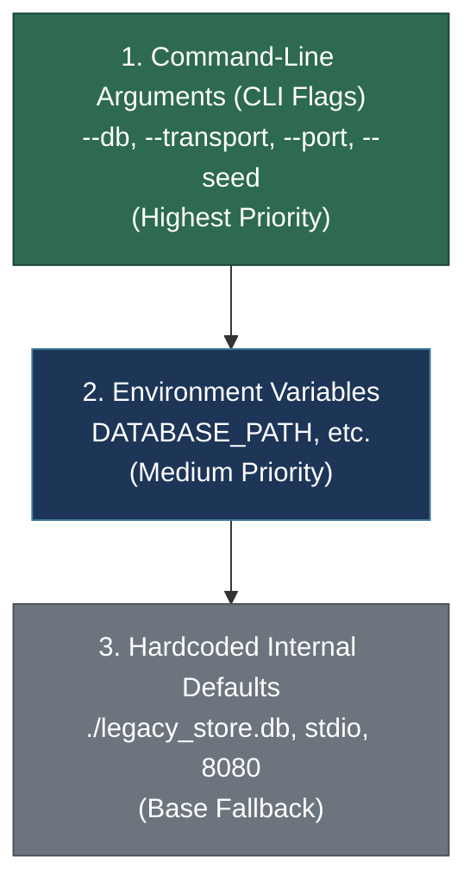
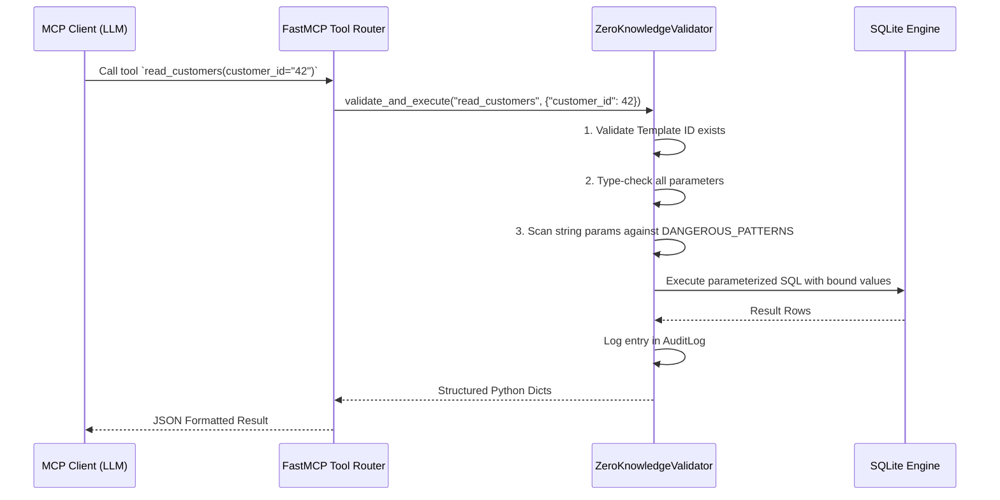
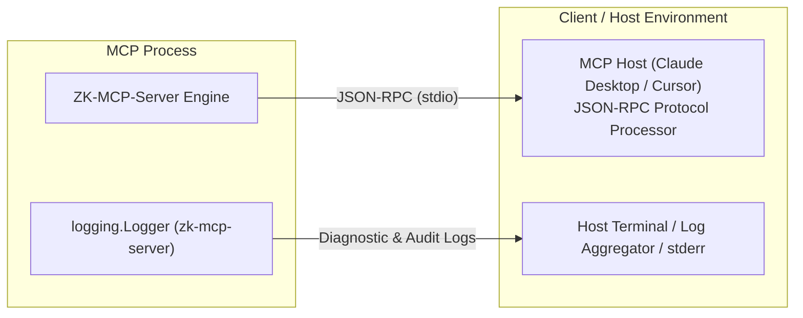

# Configuration Reference Guide — Self-Documenting Zero-Knowledge MCP Server

This document provides a comprehensive configuration reference for the **Self-Documenting Zero-Knowledge MCP Server** ([`server.py`](file:///Users/utkarshsrivastava/Desktop/Self-Documenting-Zero-Knowledge-MCP-Server/server.py)). It covers runtime startup options, environment overrides, SQLite database engine pragmas, internal tuning boundaries, defense-in-depth security policies, and protocol logging architecture.

---

## Table of Contents

1. [Configuration Hierarchy & Precedence](#1-configuration-hierarchy--precedence)
2. [Command-Line Arguments](#2-command-line-arguments)
3. [Environment Variables](#3-environment-variables)
4. [Database Engine Settings](#4-database-engine-settings)
5. [Internal Tuning Parameters](#5-internal-tuning-parameters)
6. [Security Configuration](#6-security-configuration)
   - [Zero-Knowledge Execution Model](#zero-knowledge-execution-model)
   - [Dangerous Patterns Blocklist](#dangerous-patterns-blocklist)
   - [Type Validation Mapping](#type-validation-mapping)
   - [Parameter Sanitization Pipeline](#parameter-sanitization-pipeline)
7. [Logging Configuration](#7-logging-configuration)
   - [Stream Separation (stderr vs stdout)](#stream-separation-stderr-vs-stdout)
   - [Log Format & Levels](#log-format--levels)
   - [Audit Logging Format](#audit-logging-format)
   - [Critical Stdout Hygiene](#critical-stdout-hygiene)
8. [Common Configuration Recipes](#8-common-configuration-recipes)
9. [Configuration Troubleshooting Reference](#9-configuration-troubleshooting-reference)

---

## 1. Configuration Hierarchy & Precedence

The server resolves configuration values using a strict three-tier priority ladder:



### Precedence Rules

1. **Command-Line Arguments (`CLI`)**: Values explicitly supplied as flags during server invocation take absolute precedence and override all lower layers.
2. **Environment Variables (`ENV`)**: If a CLI flag is omitted, the server checks the host environment (or an active `.env` file) for relevant variables (such as `DATABASE_PATH`).
3. **Hardcoded Defaults (`DEFAULTS`)**: When neither a CLI flag nor an environment variable is supplied, fallback defaults declared in [`server.py`](file:///Users/utkarshsrivastava/Desktop/Self-Documenting-Zero-Knowledge-MCP-Server/server.py#L50-L55) are utilized.

#### Resolution Example for Database Path
```
--db /var/data/custom.db  >  DATABASE_PATH=/etc/app.db  >  ./legacy_store.db
```

> [!NOTE]
> If `--db` is passed on the command line, `DATABASE_PATH` is ignored. If `--db` is omitted, the server evaluates `os.environ.get("DATABASE_PATH")`. If `DATABASE_PATH` is unset, the server defaults to resolving `legacy_store.db` relative to the directory containing [`server.py`](file:///Users/utkarshsrivastava/Desktop/Self-Documenting-Zero-Knowledge-MCP-Server/server.py).

---

## 2. Command-Line Arguments

Command-line flags are parsed by [`parse_args()`](file:///Users/utkarshsrivastava/Desktop/Self-Documenting-Zero-Knowledge-MCP-Server/server.py#L57-L79) using Python's standard `argparse` library.

| Flag | Type | Allowed Values | Default | Description |
|---|---|---|---|---|
| `--db` | `string` | Any valid file path | `DATABASE_PATH` env or `./legacy_store.db` | Absolute or relative path to the SQLite database file to introspect and manage. |
| `--transport` | `string` | `stdio`, `sse` | `stdio` | MCP transport protocol. `stdio` is used for desktop clients (Claude Desktop, Cursor); `sse` (Server-Sent Events) is used for network-accessible HTTP services. |
| `--port` | `integer` | `1024`–`65535` | `8080` | Network port for listening when `--transport sse` is active. Ignored when running over `stdio`. |
| `--seed` | `flag` | None (Boolean switch) | `False` | When present, seeds sample e-commerce tables and records into the target database prior to schema introspection and startup. |

### CLI Invocation Examples

#### Standard Stdio Mode (Default for Claude Desktop / Cursor)
```bash
python server.py
```

#### Custom Database Path
```bash
python server.py --db /data/warehouse/inventory.db
```

#### Networked SSE Service on Port 9090
```bash
python server.py --transport sse --port 9090
```

#### Demo Bootstrap (Seed Demo Store and Start)
```bash
python server.py --seed --db ./demo_store.db
```

#### Full Production SSE Bootstrap
```bash
python server.py --db /srv/sqlite/legacy_store.db --transport sse --port 8080
```

---

## 3. Environment Variables

The server inspects host environment variables during the bootstrapping phase.

| Variable | Type | Default | Description |
|---|---|---|---|
| `DATABASE_PATH` | `string` | `./legacy_store.db` (relative to `server.py`) | Overrides the default filesystem path to the SQLite database when `--db` is not supplied via the CLI. |

### Environment Configuration via `.env`

An example configuration file is provided in the repository root as [`.env.example`](file:///Users/utkarshsrivastava/Desktop/Self-Documenting-Zero-Knowledge-MCP-Server/.env.example):

```bash
# Path to the SQLite database file.
# Default: ./legacy_store.db (auto-generated via --seed)
DATABASE_PATH=./legacy_store.db
```

To use this file in production or containerized environments:

```bash
cp .env.example .env
export $(cat .env | xargs)
python server.py
```

---

## 4. Database Engine Settings

All database connections are initiated and managed by the [`ZeroKnowledgeValidator._get_connection()`](file:///Users/utkarshsrivastava/Desktop/Self-Documenting-Zero-Knowledge-MCP-Server/src/security.py#L106-L111) method in [`src/security.py`](file:///Users/utkarshsrivastava/Desktop/Self-Documenting-Zero-Knowledge-MCP-Server/src/security.py). The server establishes fresh, isolated connections with the following mandatory runtime engine parameters:

| Setting | Implementation | Rationale & Effect |
|---|---|---|
| **Foreign Key Enforcement** | `PRAGMA foreign_keys = ON;` | SQLite disables foreign key validation by default. Enabling this pragma ensures referential integrity across all generated `CREATE`, `UPDATE`, and `DELETE` operations. Cascade constraints are strictly honored. |
| **Row Factory Mapping** | `conn.row_factory = sqlite3.Row` | Configures cursors to return rows wrapped in dictionary-accessible tuple proxies. Enables clean mapping from column names to JSON keys when delivering tool execution payloads to the MCP client. |
| **Connection Lifecycle** | Per-query scoped connection | Connections are opened inside `validate_and_execute()`, committed immediately on mutations, and closed in a `finally` block to prevent dangling locks. |
| **Transaction Isolation** | Standard SQLite Autocommit / Immediate | Write operations (`INSERT`, `UPDATE`, `DELETE`) call `conn.commit()` directly after execution, returning `affected_rows` and `last_insert_id`. |

### Filesystem Permissions

- **Read/Write (`rw`)**: The user executing `server.py` requires read and write permissions to:
  - The SQLite database file (`.db`).
  - The parent directory hosting the `.db` file (necessary for SQLite lock files, rollback journals, or WAL files: `-wal` and `-shm`).
- **Initialization & Seeding (`--seed`)**: If running with the `--seed` flag, write permissions on the directory are required to create the database file if it does not already exist.

> [!WARNING]
> Running the server against a read-only database file or within a read-only mount will cause all write templates (`CREATE`, `UPDATE`, `DELETE`) and `--seed` executions to fail with `sqlite3.OperationalError: attempt to write a readonly database`.

---

## 5. Internal Tuning Parameters

The server contains calibrated internal operational constants. These values are hardcoded in the codebase to guarantee predictable query performance and prevent large payloads from exhausting context windows in LLM clients.

| Parameter | Value | Source Location | Functional Description |
|---|---|---|---|
| **List Pagination Max** | `100` | [`src/crud_generator.py`](file:///Users/utkarshsrivastava/Desktop/Self-Documenting-Zero-Knowledge-MCP-Server/src/crud_generator.py#L68-L78)<br>[`_make_list_fn`](file:///Users/utkarshsrivastava/Desktop/Self-Documenting-Zero-Knowledge-MCP-Server/src/crud_generator.py#L68-L78) | Upper ceiling on the `limit` argument for all dynamically generated `list_{table}` tools (`safe_limit = min(max(1, limit), 100)`). Prevents the LLM from requesting unbounded result sets. |
| **List Pagination Default** | `20` | [`src/crud_generator.py`](file:///Users/utkarshsrivastava/Desktop/Self-Documenting-Zero-Knowledge-MCP-Server/src/crud_generator.py#L68-L78)<br>[`_make_list_fn`](file:///Users/utkarshsrivastava/Desktop/Self-Documenting-Zero-Knowledge-MCP-Server/src/crud_generator.py#L68-L78) | Default page size returned by `list_{table}` tools if the client does not specify an explicit `limit` parameter. |
| **Search Result Limit** | `50` | [`src/sql_templates.py`](file:///Users/utkarshsrivastava/Desktop/Self-Documenting-Zero-Knowledge-MCP-Server/src/sql_templates.py#L222-L246)<br>[`_generate_search_template`](file:///Users/utkarshsrivastava/Desktop/Self-Documenting-Zero-Knowledge-MCP-Server/src/sql_templates.py#L222-L246) | Hardcoded `LIMIT 50` appended to all full-text wildcard queries generated for `search_{table}` tools (`WHERE [col] LIKE ? LIMIT 50`). |
| **Audit Log Display Limit** | `50` | [`src/security.py`](file:///Users/utkarshsrivastava/Desktop/Self-Documenting-Zero-Knowledge-MCP-Server/src/security.py#L287-L291)<br>[`ZeroKnowledgeValidator.get_audit_log`](file:///Users/utkarshsrivastava/Desktop/Self-Documenting-Zero-Knowledge-MCP-Server/src/security.py#L287-L291) | Number of most recent query execution records returned when querying the MCP resource `security://audit-log`. |
| **Security Failure Log Limit** | `10` | [`src/security.py`](file:///Users/utkarshsrivastava/Desktop/Self-Documenting-Zero-Knowledge-MCP-Server/src/security.py#L293-L307)<br>[`ZeroKnowledgeValidator.get_security_report`](file:///Users/utkarshsrivastava/Desktop/Self-Documenting-Zero-Knowledge-MCP-Server/src/security.py#L293-L307) | Number of recent failed security events preserved in the `recent_failures` array of `security://report`. |

### Tuning Parameter Code References

#### List Pagination Bounds ([`src/crud_generator.py`](file:///Users/utkarshsrivastava/Desktop/Self-Documenting-Zero-Knowledge-MCP-Server/src/crud_generator.py#L68-L78))
```python
def _make_list_fn(table_name: str, template_id: str, validator: ZeroKnowledgeValidator):
    def list_tool(limit: int = 20, offset: int = 0) -> list[dict]:
        safe_limit = min(max(1, limit), 100)  # Bound: 1 to 100, default 20
        safe_offset = max(0, offset)
        return validator.validate_and_execute(
            template_id, {"limit": safe_limit, "offset": safe_offset}
        )
    return list_tool
```

#### Search Query Hard Limit ([`src/sql_templates.py`](file:///Users/utkarshsrivastava/Desktop/Self-Documenting-Zero-Knowledge-MCP-Server/src/sql_templates.py#L237-L245))
```python
self.registry.register(SQLTemplate(
    id=f"search_{table_name}",
    description=f"Search {table_name} across text columns",
    sql=f"SELECT * FROM [{table_name}] WHERE {conditions} LIMIT 50",
    params=params,
    param_types=param_types,
    operation="SEARCH",
    table=table_name,
))
```

---

## 6. Security Configuration

### Zero-Knowledge Execution Model

The server operates on a strict **Zero-Knowledge Architecture**. The client and the LLM are never granted permissions to execute arbitrary or ad-hoc SQL strings. 

1. During startup, [`DatabaseIntrospector`](file:///Users/utkarshsrivastava/Desktop/Self-Documenting-Zero-Knowledge-MCP-Server/src/introspector.py) scans the schema and registers parameterized templates into [`SQLTemplateRegistry`](file:///Users/utkarshsrivastava/Desktop/Self-Documenting-Zero-Knowledge-MCP-Server/src/sql_templates.py).
2. The LLM interacts exclusively with high-level tool names (`read_customers`, `create_orders`, etc.).
3. The server executes parameterized queries where user inputs map directly to SQLite query parameter bindings (`?`).
4. Every database interaction passes through [`ZeroKnowledgeValidator.validate_and_execute()`](file:///Users/utkarshsrivastava/Desktop/Self-Documenting-Zero-Knowledge-MCP-Server/src/security.py#L113-L182).



### Dangerous Patterns Blocklist

Even though parameterized SQL inherently prevents standard SQL injection, the server incorporates a regex-based defense-in-depth sanitization layer defined by [`DANGEROUS_PATTERNS`](file:///Users/utkarshsrivastava/Desktop/Self-Documenting-Zero-Knowledge-MCP-Server/src/security.py#L28-L44). Any string parameter value matching any of the following compiled expressions will immediately trigger a [`SecurityError`](file:///Users/utkarshsrivastava/Desktop/Self-Documenting-Zero-Knowledge-MCP-Server/src/security.py#L47-L49) and abort execution:

| Category | Regex Pattern | Blocked Attack Vector |
|---|---|---|
| **Stacked SQL Statements** | `;\s*DROP\s+` | Secondary stacked statement attempting table/view drop. |
| **Stacked SQL Statements** | `;\s*DELETE\s+` | Secondary stacked statement attempting unauthorized row deletion. |
| **Stacked SQL Statements** | `;\s*UPDATE\s+` | Secondary stacked statement attempting data alteration. |
| **Stacked SQL Statements** | `;\s*INSERT\s+` | Secondary stacked statement attempting data injection. |
| **Stacked DDL Statements** | `;\s*ALTER\s+` | Secondary statement attempting schema alteration. |
| **Stacked DDL Statements** | `;\s*CREATE\s+` | Secondary statement attempting object creation. |
| **Union Injections** | `UNION\s+SELECT` | Unauthorized multi-table data extraction or exfiltration attempts. |
| **Line Comments** | `--\s*` | SQL comment injection attempting to truncate or bypass clauses. |
| **Block Comments** | `/\*.*\*/` | SQL inline/block comment obfuscation attempts. |
| **Extended Procedures** | `xp_\w+` | Microsoft SQL Server extended procedure commands (e.g., `xp_cmdshell`). |
| **Dynamic Execution** | `exec\s*\(` | Dynamic SQL statement execution calls. |
| **Database Attachment** | `ATTACH\s+DATABASE` | SQLite-specific command to attach external database files. |
| **Database Detachment** | `DETACH\s+DATABASE` | SQLite-specific command to detach databases. |
| **Engine Pragma Injections** | `PRAGMA\s+` | SQLite PRAGMA inspection or configuration overrides. |
| **Schema Exfiltration** | `sqlite_master` | Direct query access to SQLite's internal schema catalog table. |

### Type Validation Mapping

All input parameters undergo strict type verification before query execution. Parameter types are determined from the introspected SQLite schema and mapped to Python validation functions via [`TYPE_VALIDATORS`](file:///Users/utkarshsrivastava/Desktop/Self-Documenting-Zero-Knowledge-MCP-Server/src/security.py#L89-L96):

| Discovered SQLite Type | Recognized Schema Aliases | Python Validation Rules | Permitted Data Examples |
|---|---|---|---|
| **`INTEGER`** | `INT`, `SMALLINT`, `BIGINT`, `BOOLEAN` | `isinstance(v, (int, float))` or `(isinstance(v, str) and v.isdigit())` | `42`, `1001`, `"55"`, `True` |
| **`REAL`** | `FLOAT`, `DOUBLE`, `DECIMAL`, `NUMERIC` | `isinstance(v, (int, float))` or string parsing via `float(v)` | `19.99`, `3.14159`, `"123.45"`, `50` |
| **`TEXT`** | `VARCHAR`, `CHAR`, `NVARCHAR` | `isinstance(v, str)` | `"John Doe"`, `"SKU-99201"`, `""` |
| **`BLOB`** | *(None)* | `isinstance(v, (str, bytes))` | `b"\x00\x01\x02"`, `"base64..."` |
| **`TIMESTAMP`** | `DATETIME`, `DATE`, `TIME` | `isinstance(v, str)` | `"2026-09-27T12:00:00Z"`, `"2026-09-27"` |
| **Untyped / Empty** | `""` | Any value permitted (`lambda v: True`) | Any valid JSON serializable type |

> [!TIP]
> `None` (representing SQL `NULL`) is universally permitted across all column types unless explicitly rejected by a database NOT NULL constraint during SQLite execution.

### Parameter Sanitization Pipeline

When [`ZeroKnowledgeValidator.validate_and_execute`](file:///Users/utkarshsrivastava/Desktop/Self-Documenting-Zero-Knowledge-MCP-Server/src/security.py#L113-L182) runs, validation follows this exact order:

1. **Existence Verification**: Verifies the requested `template_id` is registered in `SQLTemplateRegistry`.
2. **Missing Parameter Check**: Ensures all non-optional template parameters are provided in the incoming payload.
3. **Unexpected Parameter Check**: Rejects any extraneous parameters not declared by the template.
4. **Type Validation**: Validates each parameter against the [Type Validation Mapping](#type-validation-mapping).
5. **Pattern Sanitization**: Scans all string values against [`DANGEROUS_PATTERNS`](file:///Users/utkarshsrivastava/Desktop/Self-Documenting-Zero-Knowledge-MCP-Server/src/security.py#L28-L44).
6. **Execution & Audit Logging**: Binds parameters in placeholder order, executes the query, logs to the in-memory audit log, and returns records.

---

## 7. Logging Configuration

Logging is configured at server initialization in [`server.py`](file:///Users/utkarshsrivastava/Desktop/Self-Documenting-Zero-Knowledge-MCP-Server/server.py#L41-L48).

### Stream Separation (stderr vs stdout)



- **Standard Output (`stdout`)**: Exclusively reserved for the MCP JSON-RPC protocol stream. All tool requests, resource readings, and prompt evaluations are exchanged across stdout.
- **Standard Error (`stderr`)**: Configured as the destination for all application-level log messages, startup banners, error traces, and security audit entries.

### Log Format & Levels

The logging format is defined in [`server.py`](file:///Users/utkarshsrivastava/Desktop/Self-Documenting-Zero-Knowledge-MCP-Server/server.py#L42-L47):

| Attribute | Configured Value |
|---|---|
| **Stream** | `sys.stderr` |
| **Default Level** | `logging.INFO` |
| **Format String** | `%(asctime)s [%(levelname)s] %(name)s: %(message)s` |
| **Root Logger Name** | `zk-mcp-server` |

#### Sample Startup Output (stderr)
```
2026-09-27 18:00:01,123 [INFO] zk-mcp-server: =======================================================
2026-09-27 18:00:01,123 [INFO] zk-mcp-server:   Self-Documenting Zero-Knowledge MCP Server
2026-09-27 18:00:01,123 [INFO] zk-mcp-server:   Database: /Users/user/project/legacy_store.db
2026-09-27 18:00:01,123 [INFO] zk-mcp-server: =======================================================
2026-09-27 18:00:01,124 [INFO] zk-mcp-server: Phase 1: Introspecting database schema...
2026-09-27 18:00:01,128 [INFO] zk-mcp-server: Phase 2: Building schema registry...
2026-09-27 18:00:01,130 [INFO] zk-mcp-server: Phase 3: Generating pre-validated SQL templates...
2026-09-27 18:00:01,132 [INFO] zk-mcp-server: Phase 4: Initializing Zero-Knowledge security validator...
2026-09-27 18:00:01,135 [INFO] zk-mcp-server: Phase 5: Generating CRUD tools for all tables...
2026-09-27 18:00:01,142 [INFO] zk-mcp-server: Phase 6: Analyzing relationships and generating prompts...
2026-09-27 18:00:01,145 [INFO] zk-mcp-server: Phase 7: Registering schema resources...
2026-09-27 18:00:01,148 [INFO] zk-mcp-server: =======================================================
2026-09-27 18:00:01,148 [INFO] zk-mcp-server:   Server ready!
2026-09-27 18:00:01,148 [INFO] zk-mcp-server:   Tables discovered: 5
2026-09-27 18:00:01,148 [INFO] zk-mcp-server:   CRUD tools registered: 25
2026-09-27 18:00:01,148 [INFO] zk-mcp-server:   Prompts registered: 7
2026-09-27 18:00:01,148 [INFO] zk-mcp-server:   SQL templates: 25
2026-09-27 18:00:01,148 [INFO] zk-mcp-server:   Security: Zero-Knowledge mode (template-only execution)
2026-09-27 18:00:01,148 [INFO] zk-mcp-server: =======================================================
```

### Audit Logging Format

Every query processed by [`ZeroKnowledgeValidator`](file:///Users/utkarshsrivastava/Desktop/Self-Documenting-Zero-Knowledge-MCP-Server/src/security.py#L77-L121) logs structured audit events to stderr and stores them in memory:

#### Successful Query Audit Log
```
2026-09-27 18:05:12,842 [INFO] src.security: [AUDIT] 2026-09-27T18:05:12.841520+00:00 | read_customers | READ | SUCCESS | Rows: 1
```

#### Failed Query / Security Violation Audit Log
```
2026-09-27 18:06:01,310 [WARNING] src.security: [AUDIT] 2026-09-27T18:06:01.309812+00:00 | create_orders | CREATE | FAILED | Error: Potentially dangerous content detected in parameter 'notes': value matches blocked pattern. Input rejected.
```

### Critical Stdout Hygiene

> [!CAUTION]
> **NEVER USE `print()` OR DIRECT WRITES TO `sys.stdout` IN RUNTIME CODE.**
>
> In the MCP architecture over `stdio` transport, the MCP client parses stdout as strict JSON-RPC message frames. Emitting unformatted plaintext or debug messages to `stdout` breaks the JSON framing, causing immediate JSON decode exceptions in the client and dropping the MCP session.
>
> Always use `logger.info()`, `logger.warning()`, `logger.error()`, or `sys.stderr.write()`.

---

## 8. Common Configuration Recipes

### Recipe 1: Claude Desktop Integration (`stdio`)

Add this configuration snippet to your Claude Desktop configuration file:
- **macOS**: `~/Library/Application Support/Claude/claude_desktop_config.json`
- **Windows**: `%APPDATA%\Claude\claude_desktop_config.json`

```json
{
  "mcpServers": {
    "zero-knowledge-sqlite": {
      "command": "/path/to/venv/bin/python",
      "args": [
        "/path/to/Self-Documenting-Zero-Knowledge-MCP-Server/server.py",
        "--db",
        "/path/to/your/production.db"
      ],
      "env": {
        "PYTHONUNBUFFERED": "1"
      }
    }
  }
}
```

---

### Recipe 2: Networked Service (`sse` Transport)

Run the server as an independent daemon accessible across a private local network:

```bash
python server.py \
  --db /srv/sqlite/data.db \
  --transport sse \
  --port 8080
```

MCP SSE endpoints exposed:
- **SSE Stream**: `http://localhost:8080/sse`
- **Messages / RPC**: `http://localhost:8080/messages`

---

### Recipe 3: Quickstart & Testing with Demo Database

Automatically populate the bundled sample e-commerce database (`legacy_store.db`) and launch in `stdio` mode:

```bash
python server.py --seed
```

Or seed to a designated custom test location:

```bash
python server.py --seed --db ./test_sandbox.db
```

---

### Recipe 4: Systemd Service Unit (Linux SSE Daemon)

`/etc/systemd/system/zk-mcp.service`:

```ini
[Unit]
Description=Self-Documenting Zero-Knowledge MCP Server
After=network.target

[Service]
Type=simple
User=mcpuser
WorkingDirectory=/opt/zk-mcp-server
Environment=DATABASE_PATH=/var/lib/zk-mcp/store.db
Environment=PYTHONUNBUFFERED=1
ExecStart=/opt/zk-mcp-server/.venv/bin/python server.py --transport sse --port 8080
Restart=always
RestartSec=5
StandardOutput=journal
StandardError=journal

[Install]
WantedBy=multi-user.target
```

---

## 9. Configuration Troubleshooting Reference

| Symptom | Probable Cause | Corrective Action |
|---|---|---|
| `Database not found: <path>` (exit code 1) | Target SQLite file does not exist at specified path. | Verify `--db` path or pass `--seed` to automatically create and populate a demo database. |
| `Security violation: Potentially dangerous content detected` | A parameter value triggered one of the patterns in [`DANGEROUS_PATTERNS`](file:///Users/utkarshsrivastava/Desktop/Self-Documenting-Zero-Knowledge-MCP-Server/src/security.py#L28-L44). | Inspect the query input. Ensure parameters do not contain SQL keywords like `UNION SELECT`, `; DROP`, or comment syntax `--`. |
| `Type mismatch for parameter '<col>'` | Input parameter failed type validation in [`TYPE_VALIDATORS`](file:///Users/utkarshsrivastava/Desktop/Self-Documenting-Zero-Knowledge-MCP-Server/src/security.py#L89-L96). | Verify payload values match the column type (e.g., provide digits for `INTEGER`, float/int for `REAL`). |
| Claude Desktop disconnects / `JSONRPCParseError` | Unstructured text emitted to `stdout`. | Ensure no `print()` statements exist in runtime code. Route all diagnostics to `sys.stderr`. |
| `sqlite3.OperationalError: database is locked` | SQLite file is locked by a long-running process. | Check for concurrent write processes. Ensure no zombie `server.py` instances hold locks on `.db-wal` or journal files. |
