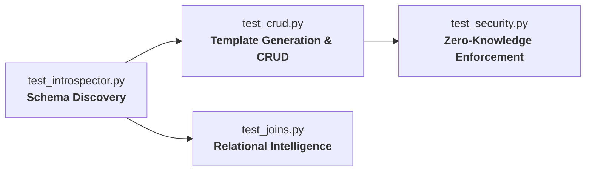
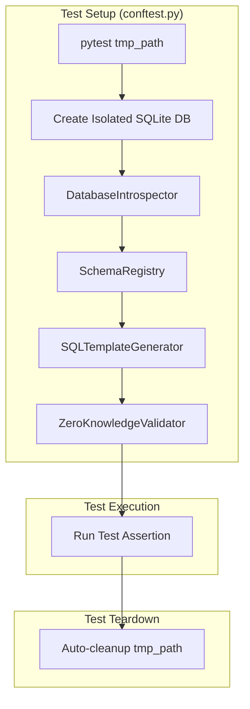
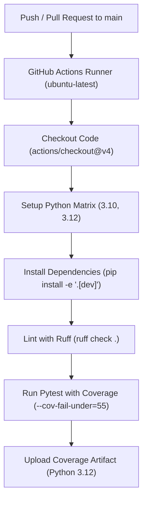

# Testing Guide — Self-Documenting Zero-Knowledge MCP Server

This testing guide provides comprehensive documentation for testing the **Self-Documenting Zero-Knowledge MCP Server**. It details the test suite architecture, instructions for executing tests, coverage expectations, CI/CD pipeline integration, guidelines for writing new tests, and code formatting/linting standards.

---

## Table of Contents

1. [Test Suite Overview](#1-test-suite-overview)
2. [Running Tests](#2-running-tests)
   - [Basic Pytest Commands](#basic-pytest-commands)
   - [Targeted Execution](#targeted-execution)
   - [Makefile Shortcuts](#makefile-shortcuts)
   - [Pytest Debugging Flags](#pytest-debugging-flags)
3. [Test Architecture](#3-test-architecture)
   - [Shared Fixtures (`conftest.py`)](#shared-fixtures-conftestpy)
   - [Test Pipeline Lifecycle](#test-pipeline-lifecycle)
   - [Zero External Dependencies & Isolation](#zero-external-dependencies--isolation)
4. [Coverage](#4-coverage)
   - [Coverage Targets and Philosophy](#coverage-targets-and-philosophy)
   - [Core Logic vs Integration Layer](#core-logic-vs-integration-layer)
   - [Coverage Enforcement](#coverage-enforcement)
5. [CI Pipeline](#5-ci-pipeline)
   - [GitHub Actions Workflow](#github-actions-workflow)
   - [Execution Steps](#execution-steps)
   - [Status Badges](#status-badges)
6. [Writing New Tests](#6-writing-new-tests)
   - [Naming Conventions](#naming-conventions)
   - [Authoring Security Tests (Positive & Negative)](#authoring-security-tests-positive--negative)
   - [Step-by-Step Example: Adding a Security Attack Vector Test](#step-by-step-example-adding-a-security-attack-vector-test)
   - [Step-by-Step Example: Testing Custom Schema Scenarios](#step-by-step-example-testing-custom-schema-scenarios)
7. [Linting & Code Formatting](#7-linting--code-formatting)
   - [Ruff Configuration](#ruff-configuration)
   - [Linting and Formatting Commands](#linting-and-formatting-commands)
8. [Troubleshooting & FAQs](#8-troubleshooting--faqs)

---

## 1. Test Suite Overview

The test suite consists of four specialized test files designed to validate every tier of the Zero-Knowledge MCP Server pipeline, from autonomous SQLite introspection to zero-knowledge SQL template enforcement:



### Test Suites Summary Table

| Test File | Module Under Test | What It Tests |
|-----------|-------------------|---------------|
| `tests/test_introspector.py` | `src/introspector.py` | **Schema discovery**: table enumeration, column metadata, primary key extraction, foreign key constraints, column types, nullability, table indexes, and row count heuristics |
| `tests/test_crud.py` | `src/crud_generator.py` + `src/sql_templates.py` | **CRUD operations**: deterministic template generation, list (pagination), read by PK, create (inserts with auto-increment), update, delete, and pattern search |
| `tests/test_security.py` | `src/security.py` | **Security enforcement**: unknown template rejection, raw SQL execution blocking, parameter validation, type checking, SQL injection pattern prevention, and audit logging |
| `tests/test_joins.py` | `src/join_analyzer.py` | **Relational analysis**: foreign key graph traversal, junction (associative) table identification, automated join query assembly, join execution, and schema summaries |

---

## 2. Running Tests

### Prerequisites
Before running tests, ensure dependencies are installed in an active virtual environment:

```bash
# Create and activate virtual environment
python3 -m venv .venv
source .venv/bin/activate

# Install development and testing dependencies
pip install -e ".[dev]"
```

### Basic Pytest Commands

Execute the test suite using standard `pytest` commands:

```bash
# Run all tests
python -m pytest

# Run with verbose output (shows each test name and pass/fail status)
python -m pytest -v

# Run with coverage report showing missing lines
python -m pytest --cov=src --cov-report=term-missing
```

### Targeted Execution

Target specific test modules, classes, or individual functions:

```bash
# Run a specific test file
python -m pytest tests/test_security.py -v

# Run a specific test function inside a file
python -m pytest tests/test_security.py::test_unknown_template_rejected -v

# Run tests matching a keyword pattern (e.g., all injection-related tests)
python -m pytest -k "injection" -v

# Run all tests in a directory
python -m pytest tests/ -v
```

### Makefile Shortcuts

For developer convenience, the project includes standard `make` targets:

```bash
# Run all tests
make test        # Runs: python -m pytest tests/ -v

# Run with full coverage report
make coverage    # Runs: python -m pytest --cov=src --cov-report=term-missing

# Run ruff linter
make lint        # Runs: ruff check .
```

### Pytest Debugging Flags

When diagnosing unexpected failures:

```bash
# Stop immediately on first failure
python -m pytest -x

# Drop into Python debugger (PDB) on failure
python -m pytest --pdb

# Show local variables in tracebacks
python -m pytest -l --tb=short

# Capture stdout/stderr during test runs (disable output capture)
python -m pytest -s
```

---

## 3. Test Architecture

The test architecture ensures complete isolation, zero flaky network dependencies, and lightning-fast execution:



### Shared Fixtures (`conftest.py`)

All shared fixtures are defined in [`tests/conftest.py`](file:///Users/utkarshsrivastava/Desktop/Self-Documenting-Zero-Knowledge-MCP-Server/tests/conftest.py). Pytest automatically discovers these fixtures across all test files:

- **`_build_stack(db_path)`**: Helper function that bootstraps the full pipeline:
  1. Instantiates `DatabaseIntrospector` against the target database.
  2. Builds the `SchemaRegistry`.
  3. Generates all parameter-bound templates via `SQLTemplateGenerator`.
  4. Returns a ready-to-test dictionary with `db_path`, `schema`, `registry`, `template_registry`, and `validator`.

- **`simple_db(tmp_path)`**:
  - Provides a single-table SQLite database containing an `items` table with columns (`id`, `name`, `price`, `quantity`, `description`).
  - Pre-seeded with sample records (`Widget`, `Gadget`).
  - Used primarily by CRUD and basic security validation tests.

- **`relational_db(tmp_path)`**:
  - Provides a normalized multi-table database with 4 tables: `authors`, `books`, `tags`, and `book_tags` (junction table).
  - Models 1-to-many (`authors` → `books`) and many-to-many relationships (`books` ↔ `tags` via `book_tags`).
  - Pre-seeded with relational data.
  - Used by `tests/test_joins.py` to test foreign key graph construction and multi-table queries.

- **`users_posts_db(tmp_path)`**:
  - Provides a 2-table schema (`users` and `posts` with foreign keys and unique constraints).
  - Used directly by `tests/test_introspector.py` for raw schema analysis.

- **`secrets_db(tmp_path)`**:
  - Creates a sensitive key-value table (`secrets` with `api_key` and `password`).
  - Used to verify that unauthorized queries or SQL injections cannot leak arbitrary table rows.

### Test Pipeline Lifecycle

Each test runs in strict isolation:
1. **Fresh In-Memory/File SQLite DB**: Pytest's built-in `tmp_path` fixture provides a distinct temporary directory per test function.
2. **Autonomous Introspection**: The introspector inspects the temporary SQLite database via `PRAGMA` queries to generate runtime schema models.
3. **Template & Validator Recompilation**: Templates and `ZeroKnowledgeValidator` instances are built fresh per test execution. No global state leaks between tests.
4. **Automatic Teardown**: Pytest automatically cleans up the temporary files after each test run.

### Zero External Dependencies & Isolation
- **No Network Access**: The test suite runs entirely offline.
- **No Mock Databases**: All tests execute against real SQLite database engines provided by Python's built-in `sqlite3` module.
- **Deterministic**: Tests do not depend on external environment variables, clock time, or network services.

---

## 4. Coverage

### Coverage Targets and Philosophy

The project employs `pytest-cov` to monitor code coverage and ensure no critical path in schema discovery or security validation goes untested.

```bash
python -m pytest --cov=src --cov-report=term-missing
```

### Core Logic vs Integration Layer

Coverage distribution reflects the architecture of the project:

| Module | Purpose | Typical Coverage |
|--------|---------|------------------|
| `src/introspector.py` | Schema discovery and PRAGMA introspection | **87–95%** |
| `src/security.py` | Security validator, parameter checking, injection defense | **90–99%** |
| `src/sql_templates.py` | Deterministic parameterized template generator | **90–99%** |
| `src/schema_registry.py` | In-memory schema and relation metadata registry | **95–100%** |
| `src/crud_generator.py` | MCP tool registration bindings (`@mcp.tool()`) | Integration layer (unit: lower) |
| `src/join_analyzer.py` | MCP prompt and join tool registration bindings | Integration layer (unit: lower) |

> [!NOTE]
> `crud_generator.py` and `join_analyzer.py` contain FastMCP server bindings that register tools and prompts with a live MCP server instance. These integration layers are thoroughly exercised via client integration tests (`tests/demo_client.py`) and live MCP inspector sessions, rather than isolated unit tests.

### Coverage Enforcement

- **Configured in `pyproject.toml`**:
  ```toml
  [tool.coverage.report]
  show_missing = true
  skip_covered = false
  fail_under = 55
  ```
- **Threshold**: The overall coverage threshold is set to **55%** in `pyproject.toml` to account for the MCP decorator integration layer while requiring near 100% coverage on all security and introspection modules.
- **CI Enforcement**: The CI pipeline will fail if overall coverage drops below the 55% mark.

To generate an HTML visual coverage report:
```bash
python -m pytest --cov=src --cov-report=html
open htmlcov/index.html   # On macOS
```

---

## 5. CI Pipeline

### GitHub Actions Workflow

Continuous Integration is automated via GitHub Actions in [`.github/workflows/ci.yml`](file:///Users/utkarshsrivastava/Desktop/Self-Documenting-Zero-Knowledge-MCP-Server/.github/workflows/ci.yml).

- **Triggers**:
  - Every `push` to the `main` branch.
  - Every `pull_request` targeting `main`.
- **Operating System**: `ubuntu-latest`
- **Matrix Testing**: Python `3.10` and `3.12`



### Execution Steps

1. **Checkout Repository**: Uses `actions/checkout@v4` with read-only token permissions (`contents: read`).
2. **Setup Python**: Uses `actions/setup-python@v5` with pip dependency caching enabled.
3. **Install Dependencies**:
   ```bash
   python -m pip install --upgrade pip
   pip install -e ".[dev]"
   ```
4. **Lint with Ruff**:
   ```bash
   ruff check .
   ```
5. **Run Tests with Coverage Check**:
   ```bash
   python -m pytest tests/ \
     --cov=src \
     --cov-report=term-missing \
     --cov-report=xml:coverage.xml \
     --cov-fail-under=55
   ```
6. **Upload Coverage Report**: Saves `coverage.xml` as a build artifact on the Python 3.12 runner for 7-day retention.

### Status Badges

The CI status badge is displayed at the top of the project `README.md`:

```markdown

```

---

## 6. Writing New Tests

### Naming Conventions

Follow standard pytest conventions:
- **Test files**: Must start with `test_` (e.g., `tests/test_export.py`).
- **Test functions**: Must start with `test_` followed by the target and expected behavior:
  ```python
  def test_<unit_of_work>_<expected_behavior>():
  # Example:
  def test_extra_parameters_rejected():
  def test_foreign_key_detection_on_composite_keys():
  ```

### Authoring Security Tests (Positive & Negative)

Security testing in a Zero-Knowledge MCP server requires verifying both sides of the contract:
1. **Positive Cases (Allowed)**: Verify legitimate, well-formed queries execute cleanly and return expected records.
2. **Negative Cases (Blocked)**: Verify that any deviation (missing arguments, unauthorized fields, malicious SQL syntax, unknown templates) is immediately intercepted and raises a `SecurityError`.

### Step-by-Step Example: Adding a Security Attack Vector Test

To add a test verifying that SQL stacked queries or subqueries are blocked:

```python
# In tests/test_security.py
import pytest
from src.security import SecurityError

def test_stacked_query_injection_blocked(secure_system):
    """
    Test that chained SQL statements (stacked queries) within parameter values
    are caught and rejected by the validator.
    """
    # Negative test case: Attempt to chain a DROP TABLE command
    with pytest.raises(SecurityError, match="dangerous content"):
        secure_system.validate_and_execute(
            template_id="search_secrets",
            params={
                "search_key": "dummy'; DROP TABLE secrets; SELECT '1",
                "search_value": "normal",
            },
        )

    # Positive test case: Verify the table was NOT dropped and remains readable
    res = secure_system.validate_and_execute(
        template_id="list_secrets",
        params={"limit": 10, "offset": 0},
    )
    assert len(res) == 2
```

### Step-by-Step Example: Testing Custom Schema Scenarios

To test introspecting tables with special constraints (e.g., `CHECK` constraints or default values):

```python
# In tests/test_introspector.py
import sqlite3
from src.introspector import DatabaseIntrospector

def test_default_values_and_nullability(tmp_path):
    """Verify that DEFAULT clauses and NOT NULL constraints are captured."""
    db_file = str(tmp_path / "custom.db")
    conn = sqlite3.connect(db_file)
    conn.execute("""
        CREATE TABLE accounts (
            id INTEGER PRIMARY KEY AUTOINCREMENT,
            username TEXT NOT NULL,
            balance REAL DEFAULT 100.0,
            is_active INTEGER DEFAULT 1
        )
    """)
    conn.close()

    introspector = DatabaseIntrospector(db_file)
    schema = introspector.introspect()

    table = schema.get_table("accounts")
    assert table is not None

    username_col = table.get_column("username")
    assert username_col.not_null is True

    balance_col = table.get_column("balance")
    assert balance_col.default_value == "100.0"
```

---

## 7. Linting & Code Formatting

The project enforces clean code standards using [Ruff](https://docs.astral.sh/ruff/), an extremely fast Python linter and formatter.

### Ruff Configuration

Ruff settings are configured in [`pyproject.toml`](file:///Users/utkarshsrivastava/Desktop/Self-Documenting-Zero-Knowledge-MCP-Server/pyproject.toml):

```toml
[tool.ruff]
target-version = "py310"
line-length = 100
exclude = [
    ".git",
    ".venv",
    "venv",
    "__pycache__",
    "build",
    "dist",
]

[tool.ruff.lint]
# Active rulesets:
# E/W = pycodestyle (errors / warnings)
# F   = pyflakes
# I   = isort (import sorting)
# UP  = pyupgrade (modern Python syntax)
select = ["E", "W", "F", "I", "UP"]
ignore = [
    "E501",   # Line-too-long (handled by line-length and formatter)
]
```

### Linting and Formatting Commands

```bash
# Check code for lint issues
ruff check .

# Automatically fix fixable lint errors (e.g. import order, unused imports)
ruff check --fix .

# Format all code files
ruff format .

# Check formatting without modifying files
ruff format --check .
```

---

## 8. Troubleshooting & FAQs

### Q: Why do tests fail with `ModuleNotFoundError: No module named 'src'`?
**A:** This occurs if the project root is not in your `PYTHONPATH` or if the package was not installed in editable mode.
Run:
```bash
pip install -e ".[dev]"
```
Or run pytest using the Python module invocation:
```bash
python -m pytest
```

### Q: Why are `crud_generator.py` and `join_analyzer.py` coverage percentages lower?
**A:** These files contain decorator registration routines (`@mcp.tool()`, `@mcp.prompt()`) designed for the FastMCP runtime engine. When executing isolated unit tests, these decorators register functions into FastMCP registries, but the network/JSON-RPC dispatch occurs during live MCP sessions or integration runs. Core business logic, template building, and security validation reside in `introspector.py`, `sql_templates.py`, and `security.py`, all of which maintain 87–99% coverage.

### Q: How do I test the full client integration end-to-end?
**A:** You can run the interactive demo client script:
```bash
python tests/demo_client.py
```
This boots an in-process MCP server, registers all discovered tools, and executes queries against the demo legacy database.

### Q: How do I inspect a temporary database created during a failed test?
**A:** Pass `-s` and add a breakpoint or `print(setup_system["db_path"])` to print the SQLite database path on disk before pytest tears down the fixture.
