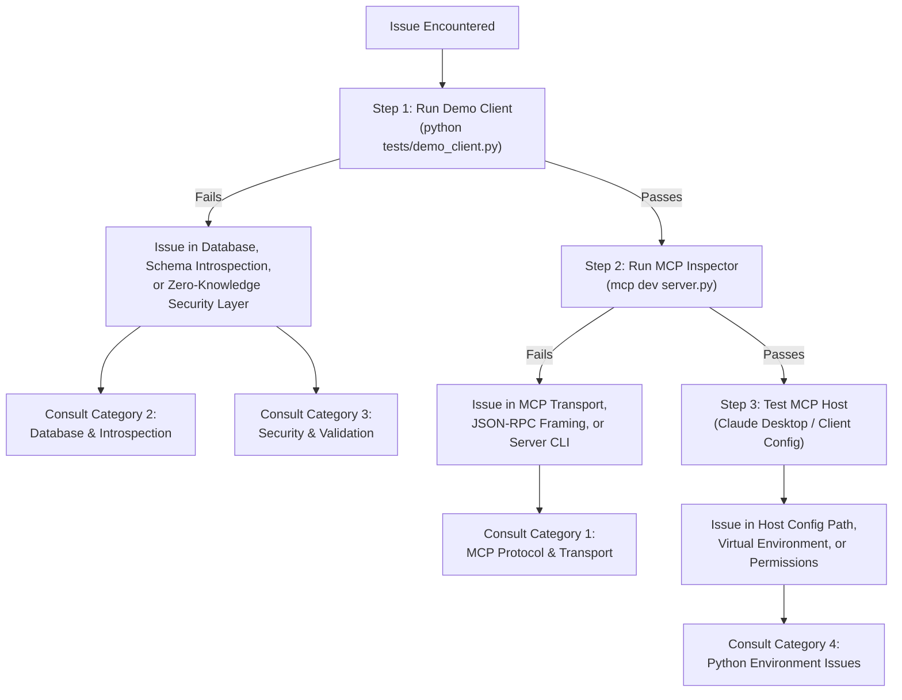

# Troubleshooting Guide — Self-Documenting Zero-Knowledge MCP Server

This guide provides diagnostic procedures, root-cause analyses, and concrete resolutions for common issues encountered when deploying, configuring, or extending the **Self-Documenting Zero-Knowledge MCP Server**.

---

## Diagnostic Flowchart

When diagnosing unexpected behavior, follow this decision tree to isolate the faulty component before modifying code or configurations:



---

## Quick Health Checks

Before digging into detailed error codes, run these three rapid triage steps to narrow down whether the issue stems from the database schema, security rules, transport framing, or client configuration.

### Step 1: Run `python tests/demo_client.py`

The demo client executes the complete core pipeline—schema introspection, schema registry indexing, SQL template generation, CRUD execution, join queries, and security enforcement—**completely independent of MCP transport and JSON-RPC serialization**.

```bash
# Ensure you are at the repository root and virtual environment is active
python tests/demo_client.py
```

* **If this command fails**:
  - The database file [`legacy_store.db`](file:///Users/utkarshsrivastava/Desktop/Self-Documenting-Zero-Knowledge-MCP-Server/server.py#L51-L55) may be missing, corrupted, or lacking expected schema constraints.
  - See [Category 2: Database & Introspection Issues](#category-2-database--introspection-issues) or [Category 3: Security & Validation Rejections](#category-3-security--validation-rejections).
* **If this command succeeds**:
  - Your database engine, schema introspection in [`DatabaseIntrospector`](file:///Users/utkarshsrivastava/Desktop/Self-Documenting-Zero-Knowledge-MCP-Server/src/introspector.py#L136-L182), template synthesis in [`SQLTemplateGenerator`](file:///Users/utkarshsrivastava/Desktop/Self-Documenting-Zero-Knowledge-MCP-Server/src/sql_templates.py), and template validation in [`ZeroKnowledgeValidator`](file:///Users/utkarshsrivastava/Desktop/Self-Documenting-Zero-Knowledge-MCP-Server/src/security.py#L77-L120) are fully healthy.
  - The failure lies in MCP transport framing, environment paths, or the host client configuration.

### Step 2: Test with MCP Inspector: `mcp dev server.py`

The official MCP Inspector launches an isolated stdio transport session wrapped in an interactive browser UI, allowing you to manually trigger tools, read resources, and inspect prompts without Claude Desktop.

```bash
# Using FastMCP dev runner
mcp dev server.py

# Alternatively, using npx directly
npx @modelcontextprotocol/inspector python server.py
```

* Navigate to the URL shown in the terminal (typically `http://localhost:5173` or `http://localhost:6274`).
* Check the **Tools** tab: Verify tools such as `list_customers`, `read_products`, and `create_orders` appear.
* Check the **Resources** tab: Read `schema://tables` and `security://templates`.
* Check the **Prompts** tab: Verify join analysis prompts (e.g. `join_orders_to_customers`).

If tools fail to appear or the inspector displays transport errors, proceed to [Category 1: MCP Protocol & Transport Failures](#category-1-mcp-protocol--transport-failures).

### Step 3: Check Stderr Log Output

The MCP stdio protocol reserves `sys.stdout` exclusively for JSON-RPC messages. All diagnostic logs from the server are directed to `sys.stderr`.

To isolate and view stderr messages directly in your shell:

```bash
# Run server with stderr redirected to terminal and stdout discarded
python server.py --seed 2>&1 >/dev/null

# Or capture stderr to a debug file
python server.py 2> server_debug.log
```

If connecting via Claude Desktop, inspect the host application's log files:
* **macOS**:
  ```bash
  tail -n 100 -f ~/Library/Logs/Claude/mcp*.log
  ```
* **Linux**:
  ```bash
  tail -n 100 -f ~/.config/Claude/logs/mcp*.log
  ```
* **Windows (PowerShell)**:
  ```powershell
  Get-Content -Path "$env:APPDATA\Claude\logs\mcp*.log" -Tail 100 -Wait
  ```

---

## Category 1: MCP Protocol & Transport Failures

### 1. JSON-RPC Parse Error in Claude Desktop / stdio

#### Symptom
Claude Desktop displays:
```text
Failed to connect to MCP server zk-database: JSON-RPC parse error: Unexpected token 'S' in JSON at position 0
```
or the connection drops immediately during initialization handshake.

#### Root Cause
**`sys.stdout` contamination.** The Model Context Protocol stdio transport communicates strictly via newline-delimited JSON-RPC messages across standard output (`stdout`). If any module, third-party dependency, or stray `print()` statement writes non-JSON-RPC text to `stdout`, the client's parser crashes on invalid framing.

#### Solution
1. **Enforce logging through `sys.stderr` only**:
   Verify that all logging throughout the codebase uses Python's standard `logging` module configured with `stream=sys.stderr`. In [`server.py`](file:///Users/utkarshsrivastava/Desktop/Self-Documenting-Zero-Knowledge-MCP-Server/server.py#L41-L47):
   ```python
   logging.basicConfig(
       level=logging.INFO,
       format="%(asctime)s [%(levelname)s] %(name)s: %(message)s",
       stream=sys.stderr,
   )
   logger = logging.getLogger("zk-mcp-server")
   ```
2. **Never use bare `print()` in runtime paths**:
   Replace any diagnostic `print(...)` statements with `logger.debug(...)` or `logger.info(...)`.
3. **Verify stdout purity**:
   Run the following pipe test from your terminal to verify that stdout emits only JSON-RPC data:
   ```bash
   python -c "
   import subprocess, json
   proc = subprocess.Popen(['python', 'server.py'], stdin=subprocess.PIPE, stdout=subprocess.PIPE, stderr=subprocess.PIPE, text=True)
   init_req = json.dumps({'jsonrpc': '2.0', 'id': 1, 'method': 'initialize', 'params': {'protocolVersion': '2024-11-05', 'capabilities': {}, 'clientInfo': {'name': 'test', 'version': '1.0'}}}) + '\n'
   stdout, stderr = proc.communicate(input=init_req, timeout=5)
   print('STDOUT received:', stdout[:120])
   "
   ```
   Ensure no banner strings, debug text, or warnings appear in `STDOUT received`.

---

### 2. Claude Desktop Cannot Connect / Server Exits Immediately

#### Symptom
In Claude Desktop, the server indicator remains red or displays "Disconnected". Checking Claude's MCP logs reveals:
```text
Server process exited with code 1
```

#### Root Cause
**Database file not found.** In [`build_server`](file:///Users/utkarshsrivastava/Desktop/Self-Documenting-Zero-Knowledge-MCP-Server/server.py#L87-L97), [`server.py`](file:///Users/utkarshsrivastava/Desktop/Self-Documenting-Zero-Knowledge-MCP-Server/server.py) verifies the database file exists prior to schema introspection:
```python
if not os.path.exists(db_path):
    logger.error(f"Database not found: {db_path}")
    logger.error("Run with --seed flag to create a demo database, or specify --db path")
    sys.exit(1)
```
When Claude Desktop spawns the server, its default working directory (`cwd`) is typically the user's home directory (`~`), **not** the repository root. A relative path like `legacy_store.db` will therefore resolve to `~/legacy_store.db`, which does not exist.

#### Solution
1. **Seed the database if not yet created**:
   ```bash
   cd /Users/utkarshsrivastava/Desktop/Self-Documenting-Zero-Knowledge-MCP-Server
   python server.py --seed
   ```
2. **Use absolute paths in `claude_desktop_config.json`**:
   Specify absolute paths for both the virtual environment Python executable and the database location:
   ```json
   {
     "mcpServers": {
       "zk-database": {
         "command": "/Users/utkarshsrivastava/Desktop/Self-Documenting-Zero-Knowledge-MCP-Server/.venv/bin/python",
         "args": [
           "/Users/utkarshsrivastava/Desktop/Self-Documenting-Zero-Knowledge-MCP-Server/server.py",
           "--db",
           "/Users/utkarshsrivastava/Desktop/Self-Documenting-Zero-Knowledge-MCP-Server/legacy_store.db"
         ]
       }
     }
   }
   ```
   Alternatively, set the `DATABASE_PATH` environment variable in the config:
   ```json
   "env": {
     "DATABASE_PATH": "/Users/utkarshsrivastava/Desktop/Self-Documenting-Zero-Knowledge-MCP-Server/legacy_store.db"
   }
   ```

---

### 3. SSE Transport: "Address already in use: 8080"

#### Symptom
Starting the server in SSE mode:
```bash
python server.py --transport sse --port 8080
```
Fails with:
```text
OSError: [Errno 48] Address already in use
ERROR:    [Errno 48] error while attempting to bind on address ('0.0.0.0', 8080): address already in use
```

#### Root Cause
Another process (such as a previous instance of `server.py`, a local HTTP server, or a Docker container) is already bound to TCP port `8080`.

#### Solution
1. **Specify an alternate port via `--port`**:
   ```bash
   python server.py --transport sse --port 9090
   ```
   Ensure your SSE client configuration connects to `http://localhost:9090/sse`.

2. **Locate and terminate the occupying process**:
   ```bash
   # On macOS / Linux: Find process on port 8080
   lsof -i :8080

   # Kill the specific process ID
   kill -9 <PID>

   # Or kill in one command:
   kill $(lsof -t -i :8080)
   ```
   On Windows (PowerShell):
   ```powershell
   Get-Process -Id (Get-NetTCPConnection -LocalPort 8080).OwningProcess | Stop-Process -Force
   ```

---

## Category 2: Database & Introspection Issues

### 1. Foreign Key Relationships / Join Prompts Missing

#### Symptom
- The server starts without errors, but calling the MCP resource `schema://tables` lists 0 relationships.
- Prompt templates such as `join_orders_to_customers` or `join_order_items_to_products` are completely missing.
- Join Analyzer logs: `Discovered 0 relationships, registered 0 prompts`.

#### Root Cause
1. **Missing Foreign Key DDL**: The SQLite tables were created without explicit `FOREIGN KEY (...) REFERENCES ...` constraints. SQLite does not deduce relationships purely from column naming conventions (e.g. naming a column `customer_id` does not establish an FK constraint in SQLite catalog tables).
2. **Introspection Query Relies on `PRAGMA foreign_key_list`**: [`DatabaseIntrospector._discover_foreign_keys`](file:///Users/utkarshsrivastava/Desktop/Self-Documenting-Zero-Knowledge-MCP-Server/src/introspector.py#L205-L216) queries:
   ```sql
   PRAGMA foreign_key_list([table_name]);
   ```
   If the table schema lacks explicit constraint definitions, this PRAGMA returns an empty result set.

#### Solution
1. **Verify table schema in SQLite**:
   ```bash
   sqlite3 legacy_store.db .schema orders
   ```
   Examine whether explicit foreign keys exist:
   ```sql
   -- Correct schema with explicit foreign keys:
   CREATE TABLE orders (
       id INTEGER PRIMARY KEY AUTOINCREMENT,
       customer_id INTEGER NOT NULL,
       order_date TIMESTAMP DEFAULT CURRENT_TIMESTAMP,
       FOREIGN KEY (customer_id) REFERENCES customers(id)
   );
   ```
2. **Re-seed using the provided seed utility**:
   If testing against sample data, re-run the seed script to restore relations:
   ```bash
   python server.py --seed
   ```
3. **Ensure `PRAGMA foreign_keys = ON`**:
   Both [`DatabaseIntrospector._get_connection`](file:///Users/utkarshsrivastava/Desktop/Self-Documenting-Zero-Knowledge-MCP-Server/src/introspector.py#L145-L150) and [`ZeroKnowledgeValidator._get_connection`](file:///Users/utkarshsrivastava/Desktop/Self-Documenting-Zero-Knowledge-MCP-Server/src/security.py#L106-L111) execute `PRAGMA foreign_keys = ON`. When creating or altering custom database files, ensure foreign key constraints are not disabled.

---

### 2. Read/Update/Delete Tools Missing for a Table

#### Symptom
A table exists in `schema://tables`, but only `list_{table}` and `search_{table}` tools are registered. `read_{table}`, `update_{table}`, and `delete_{table}` are absent from the tool registry.

#### Root Cause
**By design, the table does not have a Primary Key column.**

In [`CRUDGenerator`](file:///Users/utkarshsrivastava/Desktop/Self-Documenting-Zero-Knowledge-MCP-Server/src/crud_generator.py#L161-L228):
```python
def _generate_read_tool(self, table_name: str) -> None:
    table = self.schema.get_table(table_name)
    if not table or not table.primary_key_columns:
        return  # Skipped: cannot read by PK

def _generate_update_tool(self, table_name: str) -> None:
    table = self.schema.get_table(table_name)
    if not table or not table.primary_key_columns or not table.non_pk_columns:
        return  # Skipped: requires PK and updatable columns

def _generate_delete_tool(self, table_name: str) -> None:
    table = self.schema.get_table(table_name)
    if not table or not table.primary_key_columns:
        return  # Skipped: cannot delete safely without PK
```
Without a primary key, individual rows cannot be addressed deterministically. To prevent unintended modifications across the dataset, point-operation CRUD tools are intentionally omitted.

#### Solution
1. **Verify primary key presence**:
   ```bash
   sqlite3 legacy_store.db "PRAGMA table_info('table_name');"
   ```
   Check column 5 (`pk`). If all columns have `pk = 0`, no primary key is designated.
2. **Add a Primary Key to the table**:
   In SQLite, existing tables cannot be altered directly to add a primary key. Re-create the table with a primary key:
   ```sql
   -- Create backup table with primary key
   CREATE TABLE table_name_new (
       id INTEGER PRIMARY KEY AUTOINCREMENT,
       column1 TEXT,
       column2 INTEGER
   );

   -- Migrate data
   INSERT INTO table_name_new (column1, column2) SELECT column1, column2 FROM table_name;

   -- Replace original table
   DROP TABLE table_name;
   ALTER TABLE table_name_new RENAME TO table_name;
   ```
3. Restart the server. [`DatabaseIntrospector`](file:///Users/utkarshsrivastava/Desktop/Self-Documenting-Zero-Knowledge-MCP-Server/src/introspector.py#L136-L182) will now identify `id` as `is_primary_key = True`, and `read_`, `update_`, and `delete_` tools will be registered automatically.

---

### 3. Search Tool Not Generated for a Table

#### Symptom
`list_{table}` and `read_{table}` exist, but `search_{table}` is not registered for a specific table.

#### Root Cause
[`CRUDGenerator._generate_search_tool`](file:///Users/utkarshsrivastava/Desktop/Self-Documenting-Zero-Knowledge-MCP-Server/src/crud_generator.py#L248-L257) only generates full-text search tools for tables containing text-compatible columns:
```python
text_cols = [c for c in table.columns if c.data_type.upper() in ("TEXT", "VARCHAR", "CHAR", "")]
if not text_cols:
    return  # No text columns available to search
```
If a table contains exclusively non-text columns (such as `INTEGER`, `REAL`, `BLOB`, or `DATETIME`), no search tool is generated.

#### Solution
1. Check the table's column types:
   ```bash
   sqlite3 legacy_store.db "PRAGMA table_info('table_name');"
   ```
2. If text search is needed, modify or add columns with type `TEXT` or `VARCHAR`.
3. If searching or filtering on numeric or timestamp columns, use the `list_{table}` tool and filter within your client application.

---

### 4. SQLite Lock Errors (`database is locked`)

#### Symptom
Executing write operations (such as `create_*`, `update_*`, or `delete_*`) results in:
```text
sqlite3.OperationalError: database is locked
```

#### Root Cause
**SQLite single-writer concurrency contention.** By default, SQLite operates in rollback journal mode (`journal_mode=DELETE`), which takes an exclusive lock during write transactions. While a write lock is active, all concurrent readers and writers are blocked. Under multi-agent workloads or rapid successive calls, lock contention triggers a timeout error.

#### Solution
1. **Enable Write-Ahead Logging (WAL) Mode**:
   WAL mode allows multiple concurrent readers to proceed uninterrupted while a single writer commits changes:
   ```bash
   sqlite3 legacy_store.db "PRAGMA journal_mode=WAL;"
   ```
   Verify the mode change:
   ```bash
   sqlite3 legacy_store.db "PRAGMA journal_mode;"
   # Returns: wal
   ```
2. **Verify proper connection lifecycle**:
   Ensure custom code does not keep open connection handles across requests. In [`ZeroKnowledgeValidator.validate_and_execute`](file:///Users/utkarshsrivastava/Desktop/Self-Documenting-Zero-Knowledge-MCP-Server/src/security.py#L154-L175), connections are closed cleanly in a `finally` block:
   ```python
   conn = self._get_connection()
   try:
       # execution logic
   finally:
       conn.close()
   ```

---

## Category 3: Security & Validation Rejections

### 1. `SecurityError: Unknown template '<id>'`

#### Symptom
Tool or prompt execution fails with:
```text
src.security.SecurityError: Security violation: Unknown template 'custom_query_123'. Only pre-validated templates can be executed.
```

#### Root Cause
The client or LLM attempted to execute an arbitrary template ID or construct raw SQL. The Zero-Knowledge security architecture strictly forbids raw SQL execution. The database engine executes **only** registered templates stored in [`SQLTemplateRegistry`](file:///Users/utkarshsrivastava/Desktop/Self-Documenting-Zero-Knowledge-MCP-Server/src/sql_templates.py).

#### Solution
1. **Query registered template IDs via MCP Resource**:
   Read the `security://templates` resource using your MCP client or inspect it via the demo client:
   ```bash
   python -c "
   from src.introspector import DatabaseIntrospector
   from src.schema_registry import SchemaRegistry
   from src.sql_templates import SQLTemplateGenerator
   schema = DatabaseIntrospector('legacy_store.db').introspect()
   registry = SchemaRegistry(schema)
   templates = SQLTemplateGenerator(registry).generate_all()
   for t in templates.list_templates():
       print(f'{t.id:<30} | {t.operation:<8} | Table: {t.table}')
   "
   ```
2. **Follow naming conventions for valid templates**:
   * Create: `create_{table}`
   * Read by PK: `read_{table}`
   * Update by PK: `update_{table}`
   * Delete by PK: `delete_{table}`
   * List: `list_{table}`
   * Search: `search_{table}`
   * Join: `join_{from_table}_to_{to_table}`

---

### 2. `SecurityError: Missing required parameter '<name>'`

#### Symptom
Calling an update tool results in:
```text
src.security.SecurityError: Missing required parameter 'email' for template 'update_customers'. Required parameters: ['first_name', 'last_name', 'email', 'phone', 'address', 'city', 'country', 'created_at', 'id']
```

#### Root Cause
[`ZeroKnowledgeValidator._validate_params`](file:///Users/utkarshsrivastava/Desktop/Self-Documenting-Zero-Knowledge-MCP-Server/src/security.py#L183-L192) validates that incoming payloads contain **every** parameter expected by the underlying SQL template. 

For `update_{table}` tools, the pre-validated template updates all non-PK columns in a single atomic SQL statement:
```sql
UPDATE customers SET first_name = ?, last_name = ?, email = ?, phone = ?, address = ?, city = ?, country = ?, created_at = ? WHERE id = ?
```
Passing a partial dictionary (e.g. `{"id": 1, "first_name": "Alice"}`) fails validation because the remaining columns are missing.

#### Solution
**Follow the Read-Modify-Write pattern**:
1. Fetch the existing record using `read_{table}`:
   ```python
   # Call read_customers
   customer = read_customers({"id": 1})[0]
   ```
2. Modify only the required field in the retrieved dictionary:
   ```python
   customer["first_name"] = "Alice"
   ```
3. Pass the complete dictionary to `update_{table}`:
   ```python
   update_customers(customer)
   ```

---

### 3. `SecurityError: Type mismatch`

#### Symptom
Execution fails with:
```text
src.security.SecurityError: Type mismatch for parameter 'id': expected INTEGER, got str ('one')
```

#### Root Cause
[`ZeroKnowledgeValidator.TYPE_VALIDATORS`](file:///Users/utkarshsrivastava/Desktop/Self-Documenting-Zero-Knowledge-MCP-Server/src/security.py#L89-L96) validates that argument values match the SQLite column definitions in the schema registry:
* `INTEGER`: Must be an `int`, `float`, or digit-only string (e.g., `42` or `"42"`).
* `REAL`: Must be numeric (`int`, `float`, or parseable numeric string).
* `TEXT`: Must be a `str`.
* `BLOB`: Must be `str` or `bytes`.
* `TIMESTAMP`: Must be an ISO timestamp string.

Passing invalid types (such as passing `"abc"` for an `INTEGER` primary key, or passing a JSON dict into a `TEXT` field) triggers an immediate validation failure before SQL execution.

#### Solution
1. Check expected types by reading the table's schema resource:
   * View `schema://tables/{table_name}`
2. Ensure values are converted to appropriate data types before invocation:
   ```python
   # Incorrect
   read_products({"id": "product_five"})

   # Correct
   read_products({"id": 5})
   ```

---

### 4. `SecurityError: Potentially dangerous content detected`

#### Symptom
A legitimate insert or search query is rejected with:
```text
src.security.SecurityError: Potentially dangerous content detected in parameter 'search_address': value matches blocked pattern. Input rejected.
```

#### Root Cause
**Defense-in-depth regex filter trigger.** In addition to strict SQL parameterization, [`ZeroKnowledgeValidator._sanitize_params`](file:///Users/utkarshsrivastava/Desktop/Self-Documenting-Zero-Knowledge-MCP-Server/src/security.py#L226-L242) checks all string parameters against [`DANGEROUS_PATTERNS`](file:///Users/utkarshsrivastava/Desktop/Self-Documenting-Zero-Knowledge-MCP-Server/src/security.py#L27-L45) to prevent SQL injection smuggling and schema reconnaissance:

| Blocked Pattern | Regex | Intended Defense |
| :--- | :--- | :--- |
| `; DROP ` | `;\s*DROP\s+` | Multi-statement drop injection |
| `; DELETE ` | `;\s*DELETE\s+` | Multi-statement delete injection |
| `; UPDATE ` | `;\s*UPDATE\s+` | Multi-statement update injection |
| `; INSERT ` | `;\s*INSERT\s+` | Multi-statement insert injection |
| `; ALTER ` | `;\s*ALTER\s+` | Multi-statement schema manipulation |
| `; CREATE ` | `;\s*CREATE\s+` | Multi-statement table creation |
| `UNION SELECT` | `UNION\s+SELECT` | Union-based data extraction |
| `--` | `--\s*` | SQL line comments |
| `/* */` | `/\*.*\*/` | SQL block comments |
| `xp_` | `xp_\w+` | Extended procedure exploits |
| `exec(` | `exec\s*\(` | Dynamic command execution |
| `ATTACH DATABASE` | `ATTACH\s+DATABASE` | File attachment attacks |
| `DETACH DATABASE` | `DETACH\s+DATABASE` | Database detachment attacks |
| `PRAGMA ` | `PRAGMA\s+` | Pragma settings tampering |
| `sqlite_master` | `sqlite_master` | Direct catalog enumeration |

If a legitimate user input contains these exact sequences (e.g. searching for text with a double hyphen `--`, entering an address like `"123 Union Select Court"`, or referencing `sqlite_master`), it triggers a defense-in-depth rejection.

#### Solution
1. **Inspect the Security Audit Log**:
   Examine the rejection details and timestamp via the `security://audit-log` or `security://report` MCP resources.
2. **Rephrase the input**:
   Remove or alter substrings matching SQL comment indicators (`--`) or SQL keywords:
   * Replace em-dashes or double-hyphens (`--`) with single hyphens (`-`).
   * Avoid chaining keywords like `UNION` immediately adjacent to `SELECT`.
3. Note that this rejection is intentional defense-in-depth: untrusted inputs that resemble SQL control syntax are stopped at the security perimeter.

---

## Category 4: Python Environment Issues

### 1. Python Version Mismatch (Requires 3.10+)

#### Symptom
Starting the server or running tests fails with:
```text
TypeError: unsupported operand type(s) for |: 'type' and 'NoneType'
```
or:
```text
SyntaxError: invalid syntax
```

#### Root Cause
The codebase utilizes Python 3.10+ type union syntax (e.g. `str | None`, `list[str]`, `dict[str, Any]`). Executing with Python 3.9 or earlier fails during module AST compilation.

#### Solution
1. Verify the active Python version:
   ```bash
   python --version
   ```
2. Re-create the virtual environment with Python 3.10, 3.11, or 3.12:
   ```bash
   # Specify python3.10 or python3.11 explicitly
   python3.11 -m venv .venv
   source .venv/bin/activate
   pip install -r requirements.txt
   ```

---

### 2. Missing Dependencies

#### Symptom
```text
ModuleNotFoundError: No module named 'mcp'
```
or:
```text
ModuleNotFoundError: No module named 'pytest'
```

#### Root Cause
The active shell session is not running inside the configured virtual environment, or project dependencies have not been installed into that environment.

#### Solution
1. Activate your virtual environment:
   ```bash
   # macOS / Linux
   source .venv/bin/activate

   # Windows (cmd.exe)
   .venv\Scripts\activate.bat

   # Windows (PowerShell)
   .venv\Scripts\Activate.ps1
   ```
2. Reinstall standard requirements:
   ```bash
   pip install -r requirements.txt
   ```
3. For development and testing tools (including `pytest`):
   ```bash
   pip install -e ".[dev]"
   ```

---

### 3. Module Not Found Errors (`No module named 'src'`)

#### Symptom
Executing a script from within a subfolder (e.g. running from `tests/` or `sample_data/`):
```bash
cd tests
python demo_client.py
```
Fails with:
```text
ModuleNotFoundError: No module named 'src'
```

#### Root Cause
When executing a script in a subdirectory, Python adds that subdirectory (e.g. `.../tests`) to `sys.path[0]`, rather than the project root. Imports matching `from src...` fail because `src/` is located at the project root.

#### Solution
1. **Always execute from the project root**:
   ```bash
   cd /Users/utkarshsrivastava/Desktop/Self-Documenting-Zero-Knowledge-MCP-Server
   python tests/demo_client.py
   ```
2. **Alternatively, install the package in editable mode**:
   ```bash
   pip install -e .
   ```
3. **Alternatively, prepend `PYTHONPATH`**:
   ```bash
   PYTHONPATH=. python tests/demo_client.py
   ```

---

## Diagnostic Matrix & Quick Reference

Use this reference table to map common error messages directly to their resolution:

| Error / Symptom | Location / Phase | Probable Cause | Quick Resolution |
| :--- | :--- | :--- | :--- |
| `JSON-RPC parse error` | Claude Desktop / stdio | stdout contamination | Write logs to `sys.stderr` only; eliminate bare `print()` |
| `Database not found: <path>` | Server startup (`sys.exit(1)`) | Missing DB file or relative path | Run `python server.py --seed` or specify absolute `--db` |
| `Address already in use: 8080` | SSE transport startup | Port collision | Run with `--port 9090` or terminate existing process |
| Discovered 0 relationships | Introspection | Missing `FOREIGN KEY` DDL | Check `sqlite3 <db> .schema`; define explicit FK constraints |
| Missing `read_`, `update_`, `delete_` | Tool registration | Table lacks Primary Key | Add `INTEGER PRIMARY KEY` column to table schema |
| Missing `search_{table}` tool | Tool registration | No `TEXT` / `VARCHAR` columns | Add text columns or filter via `list_{table}` |
| `database is locked` | Write execution | SQLite concurrency conflict | Enable WAL mode: `PRAGMA journal_mode=WAL;` |
| `Unknown template '<id>'` | Security validation | Raw SQL or unregistered template | Check valid templates in `security://templates` resource |
| `Missing required parameter` | Security validation | Partial update payload | Read full row first, modify field, pass complete dict |
| `Type mismatch for parameter` | Security validation | Argument type != schema type | Pass expected type (e.g. integer vs string) |
| `Potentially dangerous content` | Security validation | String matched `DANGEROUS_PATTERNS` | Rephrase input to avoid SQL keywords or comment marks |
| `unsupported operand type(s) for \|` | Python runtime | Python version < 3.10 | Recreate `.venv` with Python `3.10+` |
| `No module named 'src'` | Python imports | Executed outside project root | Run from project root or `pip install -e .` |

---

## Verifying Audit Logs & Security Metrics

When troubleshooting unexpected rejections in production, inspect the security audit trail exposed by the MCP server.

### 1. View Recent Audit Log Entries
Read the `security://audit-log` resource via your MCP client. Each entry contains:
* `timestamp`: ISO-8601 UTC timestamp
* `template_id`: Template attempted
* `operation`: `CREATE`, `READ`, `UPDATE`, `DELETE`, `LIST`, `SEARCH`, or `JOIN`
* `table`: Target table name
* `params`: Input parameters submitted by the client
* `success`: Boolean status
* `error`: Detailed error description if execution failed
* `row_count`: Number of rows returned or affected

### 2. View Security Summary Report
Read the `security://report` resource to inspect aggregate security metrics:
```json
{
  "total_queries": 45,
  "successful": 42,
  "failed": 3,
  "registered_templates": 34,
  "recent_failures": [
    {
      "timestamp": "2026-09-27T12:00:00Z",
      "template_id": "UNKNOWN",
      "error": "Security violation: Unknown template 'raw_select'"
    }
  ]
}
```

If an LLM agent reports that queries are failing silently or returning unexpected errors, checking `security://report` immediately reveals whether the requests were blocked by parameter typing, blocklist patterns, or unregistered template IDs.
